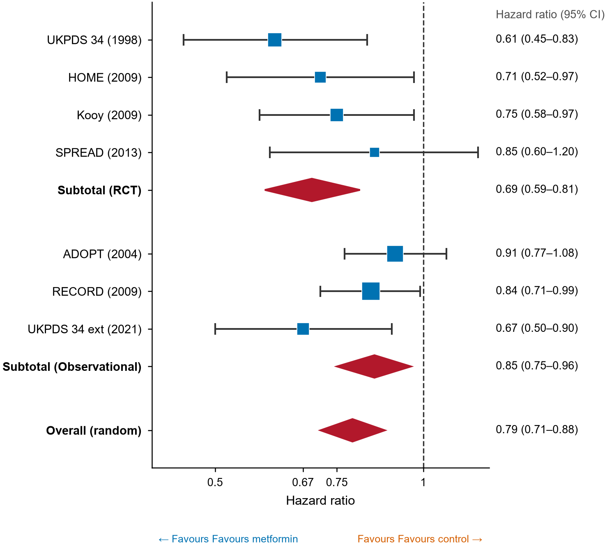
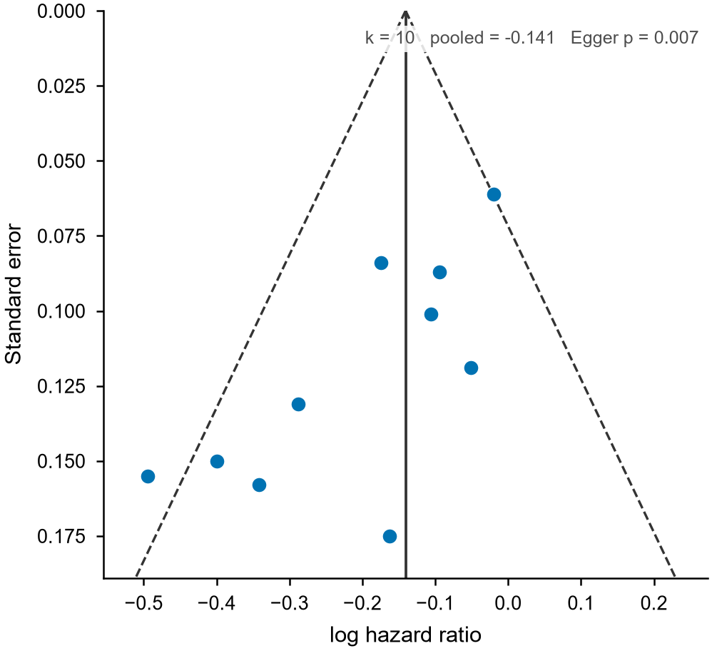
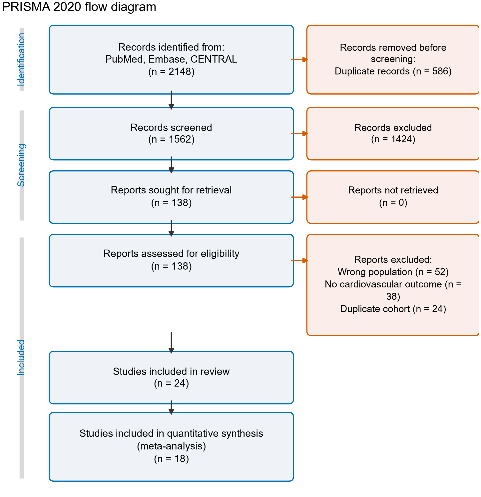
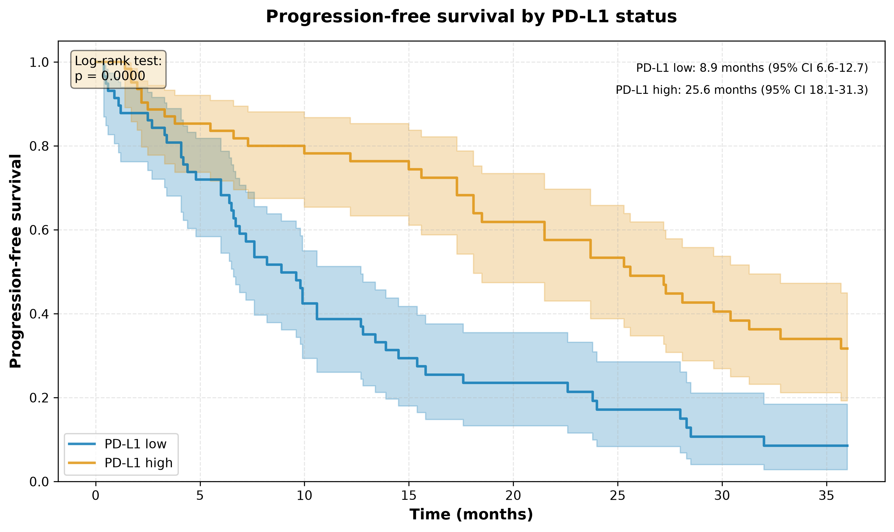
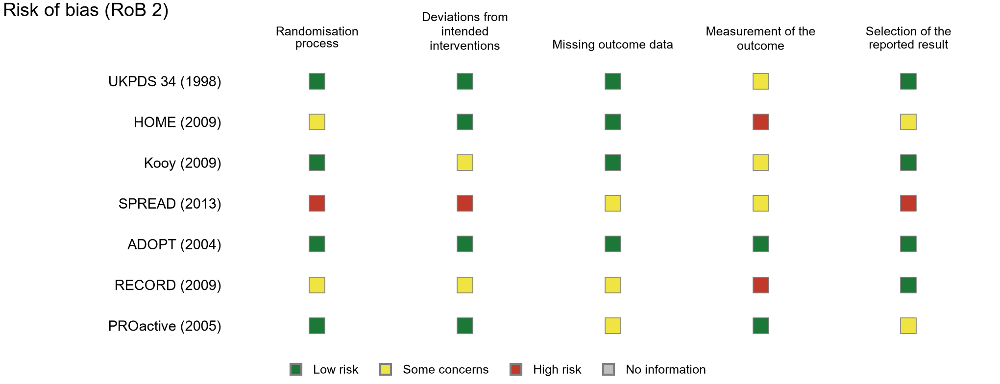

# OpenScience Dispatcher · 科研综合调度技能

> 把 [OpenScience](https://github.com/synthetic-sciences/openscience) 的 **314 个科研子技能**与
> **7 个 MCP 连接器**，装进 WorkBuddy 等通用 AI Agent 平台。
> 其中 2 个技能是本包在前述基础上自行扩展的（见 §5.3）。
> **包本体很轻**（解压约 1.6 MB）：312 个上游子技能不随包分发，用到哪个才从 Gitee 下载哪个，
> 而且只下那次任务真正需要的文件——见 [§3.7](#ondemand)。
> 子技能是「能力」，MCP 是「工具」，调度器负责把它们路由到你的问题上去。

[中文](#中文) · [English](#english) · [图表效果 / Figures](#gallery)

<div align="center">

`314` Skills · `16` Categories · `7` MCP Connectors · Apache-2.0 · Python 3.8+ · 零依赖 · 解压约 1.6 MB

</div>

---

<a id="gallery"></a>

## 图表效果 · Figure gallery

> **科研图表的绘制**是本项目的两个主打之一（另一个是「傻瓜化」）。
> 下面每一张都是**脚本从数据文件直接生成的成图**——不是示意图、不是贴图，也没有手工美化。
> 把 CSV 或一组计数交给 Agent，说一句「画个森林图 / 漏斗图 / PRISMA 流程图」，得到的就是这个质量。

| 森林图 Forest plot | 漏斗图 Funnel plot |
|---|---|
|  |  |
| 效应量合并 · 亚组分析 · 合并菱形 | 发表偏倚 · Egger 检验 · 伪 95% 区间 |

| PRISMA 2020 流程图 | 生存曲线 Kaplan-Meier |
|---|---|
|  |  |
| 识别 → 筛选 → 纳入，计数自动校验 | 分组曲线 · 置信区间 · 风险人数表 |

**偏倚风险总结图 Risk-of-bias summary（RoB 2 / ROBINS-I）**



逐研究 · 逐域评价 · Cochrane 红黄绿配色。

**更多图形 More figures**：折线图 · 散点图 · 箱线图 · 小提琴图 · 热图 · 火山图 · 富集气泡图 · ROC 曲线 · 通路图 · 分子结构式，
由 `matplotlib` / `seaborn` / `plotly` / `scientific-visualization` 生成。

> 输出规格：PDF + PNG、300 dpi、字体嵌入（Type-42）、色盲友好配色。
> 森林图 / 漏斗图 / PRISMA / 偏倚风险出自本包 `local-skills/visualization/meta-analysis-figures/`（内置数值一致性校验，CI 填反或计数矛盾时拒绝出图），
> 生存曲线出自 `skills/biology/clinical-decision-support/`。
> 图中所用为**示例数据**，仅用于展示出图效果；重新生成：`python tools/make_demo_figures.py`。

---

<a id="中文"></a>

## 中文

<a id="困境"></a>

### 一、当代本科生与硕士生，到底卡在哪里

科研训练里最难的部分，从来不是「不知道某个知识点」，而是**没有人系统教过你研究方法本身**。
课程给你知识地图，却不给你做研究的手艺。于是绝大多数人是在一次次踩坑里自学，而这些坑高度重复：

| 困境 | 具体表现 |
|---|---|
| **方法学断层** | 实验设计（对照、随机化、样本量、混杂因素）、统计检验的选择、多重比较校正、效应量与置信区间——几乎全靠自学，选错检验是常态 |
| **工具链碎片化** | 一个课题要同时碰 Python/R、测序流程、分子对接、统计建模、绘图、LaTeX、文献管理、数据库 API。每样工具的安装与语法都要重新学一遍 |
| **「最后一公里」** | 明明知道 UniProt / PDB / ChEMBL / GEO 里有数据，却卡在不会写 API 调用；明明知道 Scanpy / GROMACS 能算，却卡在环境装不上 |
| **算力与成本** | 想跑个模型却没有 GPU；云平台不熟、怕误开资源烧钱，于是很多想法在「跑不动」这一步就停了 |
| **论文从零到一** | 结构怎么搭、图表怎么规范、目标期刊什么模板、cover letter 怎么写、审稿意见怎么回——全靠摸索，且没人给反馈 |
| **时间被撕裂** | 课业 + 组会 + 实验 + 考研/申博 + 实习，留给「补方法」的整块时间极少 |
| **AI 用不对反而有害** | 大模型能生成看似专业的段落与代码，但缺少方法学约束时，会产出「格式正确、结论错误」的内容，比不会更危险 |

一句话：**科研的门槛不在智力，在于没人把「方法 + 工具 + 数据 + 算力」串成一条能走通的路。**

<a id="能做什么"></a>

### 二、这个项目能帮你做什么

它把 OpenScience 沉淀的科研方法论与工具链，变成你 Agent 里随时可调的能力。按典型场景：

**1. 从零开始写一篇论文（主打功能）**
这条路径已固化成**端到端工作流**，不是零散工具堆叠。给一个题目，它先问清楚必要信息，再按十个阶段推进，
每阶段结束用人话交代做了什么、为什么、结果说明什么：

| 阶段 | 做什么 | 你拿到的产物 |
|---|---|---|
| 0 信息采集 | 分轮提问（每轮 ≤4 问），把题目变成可研究的问题（PICO） | 研究简报 |
| 1 可行性查证 | 确认有没有人做过同题研究，确定你的差异点 | 新颖性论证 |
| 2 检索 | 构造可复现的检索式，抓取原始文献记录 | 检索策略 + 原始记录 |
| 3 筛选 | 去重 → 标题摘要筛 → 全文筛（PRISMA 规范） | 筛选表 + 流程图数据 |
| 4 提取 | 提取研究数据 + 偏倚风险评价（Cochrane RoB / NOS） | 数据提取表 |
| 5 统计 | 效应量合并、异质性、亚组、敏感性、发表偏倚 | 统计脚本 + 结果文件 |
| 6 图表 | 森林图、漏斗图、PRISMA 流程图（全部程序化生成） | 300 dpi 图 |
| 7 写作 | IMRaD 结构英文稿 + 可解析的参考文献 | 稿件 + BibTeX |
| 8 审计 | 引用逐条解析、数字回溯、主张核验、模拟同行评审 | 反造假审计报告 |
| 9 投稿 | 目标期刊推荐、格式排版、Cover Letter | 投稿材料 |

**六条铁律**：绝不编造文献、绝不编造数据、先查证再动笔、全程留痕、每步说人话、不确定就问。
支撑它的子技能包括 `scientific-writing`、`literature-review`（含 PRISMA）、`citation-management`、
`statistical-analysis`、`pubmed-database`、`matplotlib`、`verify` / `sources` / `peer-review` 等。
完整定义见 `workflows/sci-paper.md`，或运行 `dispatch.cmd workflow show sci-paper`。

**2. 设计实验与分析数据**
`statistical-analysis`（检验选择与报告）、`pymc-bayesian-modeling`（贝叶斯建模）、
`scikit-survival`（生存分析）、`statsmodels`、`shap`（可解释性）、`exploratory-data-analysis`、
`pymoo`（多目标优化）、`simpy`（离散事件仿真）。

**3. 文献调研、选题与自我审查**
`research-lookup` / `perplexity-search`（实时联网检索）、`hypothesis-generation`（假设生成）、
`scientific-problem-selection`（选题与项目构思）、`scientific-critical-thinking`（批判性评估）、
`peer-review` / `review` / `verify` / `reproduce` / `sources`（结论核查、复现与来源审计）。

**4. 干湿实验的衔接**
`molecular-cloning`（克隆设计与 PCR 预测）、`opentrons-integration` / `pylabrobot`（液体处理自动化）、
`flow-cytometry-analysis`、`protocolsio-integration`、`pydicom` / `clinical-imaging`（医学影像）、
`pathml` / `histolab`（病理切片）、`immunology-assays`、`pharmacology-wetlab`。

**5. 计算、建模与组学分析**
`scanpy` / `anndata` / `scvi-tools`（单细胞）、`pydeseq2`（差异表达）、`biopython` / `pysam` / `deeptools`（序列与 NGS）、
`rdkit` / `datamol` / `deepchem` / `diffdock` / `admet-prediction`（化学与药物发现）、
`pymatgen`（材料）、`astropy`（天文）、`neural-operator` / `pinn-training`（科学机器学习）、
`qiskit` / `cirq` / `pennylane` / `qutip`（量子计算）。

**6. 大模型训练与推理**
`transformers` / `peft` / `trl` / `unsloth-fine-tuning` / `axolotl` / `llama-factory`（微调）、
`deepspeed` / `pytorch-lightning` / `ray-train`（分布式训练）、`serving-llms-vllm` / `sglang` /
`llama-cpp` / `tensorrt-llm`（推理部署）、`mlflow` / `weights-and-biases`（实验追踪）。

**7. 借算力，也管住成本**
`cloud-compute` 分类下的 `skypilot-multi-cloud-orchestration`、`modal-serverless-gpu`、
`runpod-gpu-cloud`、`vast-ai-gpu-cloud`、`lambda-gpu-cloud`、`tinker-fine-tuning` 等，
配合 MCP 连接器直接操作云上 GPU。

**8. 让结果可复现、可交付**
`iso-13485-certification`（医疗器械质量体系文档）、`research-grants`（基金申请书）、
`market-research-reports`、`get-available-resources`（先探测本机算力再决定方案）。

**怎么用**：直接用自然语言提问即可，调度器会检索命中的子技能并载入其正文；需要真的动手时，再按需安装 MCP。

```bash
dispatch.cmd workflow show sci-paper     # 读取「从零写 SCI 论文」完整工作流
dispatch.cmd query "单细胞 降维 聚类"      # 检索能力
dispatch.cmd load scanpy                 # 载入该子技能的完整方法论
dispatch.cmd mcp install github          # 生成 MCP 安装方案（默认只看不写）
```

<a id="使用"></a>

### 三、如何安装与使用（零基础，照着做就行）

这一节写给完全不懂编程的人。**不需要会写代码，也不需要显卡。**

#### 3.1 先搞清两个名词

| 名词 | 大白话 | 你要做的事 |
|---|---|---|
| **AI Agent 平台** | 你平时提问的那个 AI 对话框（本文以 WorkBuddy 为例，其它支持「技能 / Skill」的平台同理） | 装好、能正常对话 |
| **技能（Skill）** | 一包「科研方法说明书」。AI 平时不碰它，你一提问它才去翻 | 把这个文件夹放对位置 |

放对位置之后就一直在那儿了，不用每次重装。

#### 3.2 安装：三步

**第 1 步 · 下载**

打开本仓库页面 → 点绿色的 **「克隆/下载」** → **「下载 ZIP」**，得到一个约 8 MB 的压缩包
（仓库里含全部子技能，装完即可离线使用）。
若你装的是 skillhub / clawhub 上的**精简版**（约 1 MB），上游子技能会在真正用到时按需下载——见 [§3.7](#ondemand)。

**第 2 步 · 找到技能目录**

Windows：按 `Win + R`，粘贴下面这行后回车——

```
%USERPROFILE%\.workbuddy\skills
```

macOS：Finder → 顶部菜单「前往」→「前往文件夹」→ 粘贴 `~/.workbuddy/skills`

> 文件夹不存在说明平台还没建过技能目录：手动新建一个名为 `.workbuddy` 的文件夹，进去再新建 `skills`。**名字前面那个点不能丢。**
> 用其它平台的话，把 `.workbuddy\skills` 换成该平台的技能目录即可。

**第 3 步 · 解压进去**

解压后会得到 `open-science-dispatcher-main` 文件夹（Gitee 会自动加分支后缀）。
先把它**改名为 `openscience-dispatcher`**，再整个拖进 `skills` 目录。

装完的层级必须是这样（多一层、少一层都不行）：

```
skills
└── openscience-dispatcher
    ├── SKILL.md          ← 关键文件，必须在这一层
    ├── dispatch.cmd
    ├── registry.json     ← 314 个子技能的索引（总在包里）
    ├── manifest.json     ← 每个子技能由哪些文件组成、各多大（按需下载的依据）
    ├── skills\           ← 312 个上游子技能；精简版里此目录为空，用哪个下哪个
    ├── local-skills\     ← 2 个本包自研子技能，随包分发、开箱即用
    ├── docs\figures\     ← README 里的效果图
    ├── mcp\
    └── tools\
```

> **Windows 用户注意**：检索脚本需要 Python 3.8+。若没装，打开 Microsoft Store 搜「Python」装一个（免费，一分钟），装完重开对话即可。macOS 自带，可跳过这条。

#### 3.3 验证装好了没

新开一个对话，随口问一句：

> 用 OpenScience 帮我查一下二甲双胍对心血管结局的证据

回答里若出现 `unified-research-finder`、`pubmed-database`、`literature-review` 这类子技能名，就装好了。
没反应的话，九成是目录层级放错，回第 3 步对一遍。

#### 3.4 日常怎么用：说人话就行

**不用记任何命令**，也不用提「技能」两个字。把它当成一个既懂科研方法、又熟悉各种工具的师兄，用中文把事说清楚。

说清下面四件事，效果差别很大：

| 要说清楚 | 差的问法 | 好的问法 |
|---|---|---|
| **你的身份和水平** | 「帮我写论文」 | 「我是临床医学本科生，没写过综述」 |
| **具体题目** | 「研究一下糖尿病」 | 「二甲双胍对 2 型糖尿病患者心血管结局的影响」 |
| **手上有什么** | （不说） | 「我只有学校图书馆的 PubMed 权限，没有原始数据」 |
| **要什么产物** | 「整理一下」 | 「给我一份带 DOI 的文献清单 + 一张数据提取表」 |

#### 3.5 完整例子：一个临床医学科研小课题

> **场景**：你是临床医学本科生，导师让你三天后在组会上讲清「二甲双胍对 2 型糖尿病患者心血管结局的影响」。你没做过循证检索，也不知道该讲什么。

**第 1 步 · 要证据**

> 我是临床医学本科生，要在组会上讲「二甲双胍对 2 型糖尿病患者心血管结局的影响」。请检索近 10 年的随机对照试验和 meta 分析，只看成人心血管终点（MACE）相关的，给我一份带 DOI 的清单。

背后发生的事：`pubmed-database` 检索 PubMed、`literature-review` 按纳入排除标准筛选、`citation-management` 规范引文。

**第 2 步 · 把证据变成表**

> 把上面这些研究抽成一张表：研究名、发表年份、样本量、随访时长、主要终点、效应值（HR 及 95%CI）。

直接得到一张能贴进 PPT 的表。

**第 3 步 · 补方法学（最容易翻车的一步）**

> 这些研究的终点定义不完全一样，能直接合并吗？异质性怎么判断？该用固定效应还是随机效应模型？如果做不了 meta 分析，我该怎么组织这场汇报？

背后：`statistical-analysis`、`scientific-critical-thinking`。
**这一步是「AI 帮倒忙」和「AI 真帮上忙」的分界线**——跳过它，你会拿到一段格式漂亮但方法学站不住的结论。

**第 4 步 · 成稿**

> 把上面整理成一份 8 页的中文汇报稿，按背景、方法、结果、讨论、局限、参考文献的结构写，参考文献用温哥华格式。

背后：`scientific-writing`、`citation-management`。

**第 5 步 · 自查（强烈建议）**

> 逐句检查这份稿子：每个结论都要能追溯到上面那份文献清单里的具体研究，把没有出处支撑的句子单独列出来。

背后：`verify`、`sources`、`peer-review`。**这一步能挡掉大部分「看着很专业、其实是编的」内容。**

**想继续往下做**：有真实病例可走 `clinical-reports`；要设计前瞻性研究可走 `scientific-problem-selection`；要投期刊可走 `venue-templates`。

#### 3.6 常见问题

**Q：问完没反应，回答和普通 AI 一样？**
A：查目录层级，必须是 `skills\openscience-dispatcher\SKILL.md`。解压时多套了一层文件夹是最常见的原因。

**Q：需要联网吗？**
A：检索类技能（PubMed、ClinicalTrials、UniProt 等）需要联网；纯方法论技能离线可用。

**Q：要花钱吗？**
A：技能本身免费（Apache-2.0）。只有云 GPU 类技能（`runpod-gpu-cloud` 等）会产生费用，且默认只生成方案、不实际下单。

**Q：会不会自动改我文件、乱下单？**
A：不会。写 MCP 配置默认只打印方案，显式加 `--write` 才写入且自动备份；云算力类会先出方案等你确认。

**Q：需要装 Python 吗？**
A：检索脚本 `dispatch.py` 需要 Python 3.8+（Windows 去 Microsoft Store 搜「Python」免费装，macOS 自带）。实在不装也能用——Agent 会直接翻阅技能目录，只是关键词检索不如脚本准。

**Q：怎么卸载？**
A：直接删掉 `skills\openscience-dispatcher` 文件夹，无残留。

<a id="ondemand"></a>

#### 3.7 「按需下载」是怎么回事？

为了能投稿到 skillhub / clawhub（skillhub.cn 单次上传 **10 MB**、建议 ≤ 200 个文件；clawhub 总包 **50 MB**、无文件数上限），本包做了瘦身：
包里**不带 312 个上游子技能的正文**（那部分单独就有 1615 个文件 / 19.6 MB），
只带它们的**索引**（`registry.json`）和**文件清单**（`manifest.json`）。

你完全不用管这件事，Agent 会自己判断：

1. 需要某个子技能时，先跑 `plan`，把「几个文件、多大」告诉你；
2. **问你要不要下载**；
3. 你同意后它才 `fetch`，而且**只下这一次任务真正要用的那几个**（单个子技能通常是几十 KB）。

本包自研的 2 个技能（学术搜索 `unified-research-finder`、Meta 分析图件 `meta-analysis-figures`）
以及 README 顶部[图表效果](#gallery)里的出图能力，**随包分发、开箱即用，不需要任何下载**。

> **想彻底离线用？** 一句 `dispatch.py fetch --all --yes` 把 312 个上游子技能一次拉齐（约 19.6 MB），
> 之后本机不再需要联网。或者直接从 Gitee 下载仓库 ZIP——那份本来就含全部子技能。

下载源只有**一个**：`https://gitee.com/georgechou17/open-science-dispatcher`，逐文件走 raw HTTP 直连，
**不需要 git，也不需要令牌**。

> **一处已移除**：上游 `treatment-plans` 技能里的 `assets/pain_management_plan.tex`
> （内容是具体的阿片类处方剂量表）被 Gitee 的内容合规过滤拦下（`HTTP 451`），既取不回也不宜随包分发，
> 已**从仓库移除**（见 `tools/patches/remove.txt`），原先指向它的三个文件也已同步改掉。
> 所以清单里是 1615 个文件，而非上游的 1616 个。

<a id="规模"></a>

### 四、规模：314 个开源 skill + 7 个 MCP

内容主要来自 OpenScience 的源码树，按 **16 个分类**组织（另 2 个为本包自研）。
其中 312 个上游子技能**按需下载**（见 [§3.7](#ondemand)）——下表说的是它们的规模，不代表此刻已经在本地：

| 分类 | 目录 | 数量 |
|---|---|---:|
| 模型训练 | `ml-training` | 52 |
| 生物学 | `biology` | 44 |
| 科学数据库 | `databases` | 32 |
| 大模型工具 | `llm-tools` | 31 |
| 化学 | `chemistry` | 23 |
| 物理学 | `physics` | 23 |
| 科学计算 | `coding` | 20 |
| 科研流程 | `research` | 19 |
| 会话与工程 | `other` | 16 |
| 云端算力 | `cloud-compute` | 11 |
| 数据工程 | `data-engineering` | 10 |
| 论文写作 | `writing` | 10 |
| 模型推理 | `ml-inference` | 9 |
| 科学可视化 | `visualization` | 9 |
| 量子计算 | `quantum` | 4 |
| 文档解析 | `document-parsing` | 1 |
| **合计** | | **314** |

其中 243 个技能依托具体的开源项目（如 Scanpy、RDKit、vLLM、Qiskit），
69 个是 OpenScience 原创的科研方法论与工作流技能，
另 2 个由本包自行维护（`local-skills/`，不随上游重建覆盖，见 §5.3）。

> 说明：README 上游写作「309 个内置 skills」，本清单以**源码实测**为准——上游 312 个，
> 加本包自研 2 个，共 314 个含 `SKILL.md` 的技能目录。

<a id="inventory"></a>

### 五、全部清单（含源仓库链接）

#### 5.1 Skill（314 个）

| # | 技能 | 分类 | 用途 | 源仓库 |
|---:|---|---|---|---|
| 1 | `adaptyv` | 模型训练 | Cloud laboratory platform for automated protein testing and… | [Adaptyv Bio](https://www.adaptyvbio.com/) |
| 2 | `awq-quantization` | 模型训练 | Activation-aware weight quantization for 4-bit LLM compression… | [LLM Compressor (AWQ)](https://github.com/vllm-project/llm-compressor) |
| 3 | `axolotl` | 模型训练 | Expert guidance for fine-tuning LLMs with Axolotl - YAML… | [Axolotl](https://github.com/axolotl-ai-cloud/axolotl) |
| 4 | `colab-finetuning` | 模型训练 | Fine-tune LLMs on Google Colab GPUs directly from openscience. | [Google Colab](https://colab.research.google.com/) |
| 5 | `deepspeed` | 模型训练 | Expert guidance for distributed training with DeepSpeed - ZeRO… | [DeepSpeed](https://github.com/deepspeedai/DeepSpeed) |
| 6 | `distributed-llm-pretraining-torchtitan` | 模型训练 | Provides PyTorch-native distributed LLM pretraining using… | [TorchTitan](https://github.com/pytorch/torchtitan) |
| 7 | `evaluating-code-models` | 模型训练 | Evaluates code generation models across HumanEval, MBPP,… | [BigCode Evaluation Harness](https://github.com/bigcode-project/bigcode-evaluation-harness) |
| 8 | `evaluating-llms-harness` | 模型训练 | Evaluates LLMs across 60+ academic benchmarks (MMLU, HumanEval,… | [LM Evaluation Harness](https://github.com/EleutherAI/lm-evaluation-harness) |
| 9 | `fine-tuning-with-trl` | 模型训练 | Fine-tune LLMs using reinforcement learning with TRL - SFT for… | [TRL](https://github.com/huggingface/trl) |
| 10 | `geniml` | 模型训练 | When working with genomic interval data (BED files) for machine… | [Geniml](https://github.com/databio/geniml) |
| 11 | `gptq` | 模型训练 | Post-training 4-bit quantization for LLMs with minimal accuracy… | [AutoGPTQ](https://github.com/AutoGPTQ/AutoGPTQ) |
| 12 | `grpo-rl-training` | 模型训练 | Expert guidance for GRPO/RL fine-tuning with TRL for reasoning… | [Open R1](https://github.com/huggingface/open-r1) |
| 13 | `hqq-quantization` | 模型训练 | Half-Quadratic Quantization for LLMs without calibration data. | [HQQ](https://github.com/mobiusml/hqq) |
| 14 | `hugging-face-evaluation` | 模型训练 | Add and manage evaluation results in Hugging Face model cards. | [LightEval](https://github.com/huggingface/lighteval) |
| 15 | `hugging-face-model-trainer` | 模型训练 | When users want to train or fine-tune language models using TRL… | [TRL](https://github.com/huggingface/trl) |
| 16 | `huggingface-accelerate` | 模型训练 | Simplest distributed training API. | [Accelerate](https://github.com/huggingface/accelerate) |
| 17 | `implementing-llms-litgpt` | 模型训练 | Implements and trains LLMs using Lightning AI's LitGPT with 20+… | [LitGPT](https://github.com/Lightning-AI/litgpt) |
| 18 | `knowledge-distillation` | 模型训练 | Compress large language models using knowledge distillation… | [Microsoft LMOps](https://github.com/microsoft/LMOps) |
| 19 | `llama-factory` | 模型训练 | Expert guidance for fine-tuning LLMs with LLaMA-Factory - WebUI… | [LLaMA-Factory](https://github.com/hiyouga/LLaMA-Factory) |
| 20 | `mamba-architecture` | 模型训练 | State-space model with O(n) complexity vs Transformers' O(n²). | [Mamba](https://github.com/state-spaces/mamba) |
| 21 | `ml-benchmark-evaluation` | 模型训练 | Rigorous methodology for evaluating ML models on established… | [OpenScience 自研](https://github.com/synthetic-sciences/openscience/tree/main/backend/cli/skills/ml-training/ml-benchmark-evaluation) |
| 22 | `mlflow` | 模型训练 | Track ML experiments, manage model registry with versioning,… | [MLflow](https://github.com/mlflow/mlflow) |
| 23 | `model-economics` | 模型训练 | Cost modeling and ROI analysis for specialized LLM development. | [OpenScience 自研](https://github.com/synthetic-sciences/openscience/tree/main/backend/cli/skills/ml-training/model-economics) |
| 24 | `model-merging` | 模型训练 | Merge multiple fine-tuned models using mergekit to combine… | [MergeKit](https://github.com/arcee-ai/mergekit) |
| 25 | `model-pruning` | 模型训练 | Reduce LLM size and accelerate inference using pruning… | [Wanda](https://github.com/locuslab/wanda) |
| 26 | `moe-training` | 模型训练 | Train Mixture of Experts (MoE) models using DeepSpeed or… | [Megatron-DeepSpeed](https://github.com/microsoft/Megatron-DeepSpeed) |
| 27 | `nanogpt` | 模型训练 | Educational GPT implementation in ~300 lines. | [nanoGPT](https://github.com/karpathy/nanoGPT) |
| 28 | `nemo-curator` | 模型训练 | GPU-accelerated data curation for LLM training. | [NeMo Curator](https://github.com/NVIDIA/NeMo-Curator) |
| 29 | `nemo-evaluator-sdk` | 模型训练 | Evaluates LLMs across 100+ benchmarks from 18+ harnesses (MMLU,… | [NeMo Evaluator Launcher](https://pypi.org/project/nemo-evaluator-launcher/) |
| 30 | `nnsight-remote-interpretability` | 模型训练 | Provides guidance for interpreting and manipulating neural… | [NNsight](https://github.com/ndif-team/nnsight) |
| 31 | `openrlhf-training` | 模型训练 | High-performance RLHF framework with Ray+vLLM acceleration. | [OpenRLHF](https://github.com/OpenRLHF/OpenRLHF) |
| 32 | `optimizing-attention-flash` | 模型训练 | Optimizes transformer attention with Flash Attention for 2-4x… | [FlashAttention](https://github.com/Dao-AILab/flash-attention) |
| 33 | `peft-fine-tuning` | 模型训练 | Parameter-efficient fine-tuning for LLMs using LoRA, QLoRA, and… | [PEFT](https://github.com/huggingface/peft) |
| 34 | `prime-intellect` | 模型训练 | Safely inspect Prime Intellect identity and plan compute or… | [Prime Intellect](https://github.com/PrimeIntellect-ai/prime) |
| 35 | `pufferlib` | 模型训练 | High-performance reinforcement learning framework optimized for… | [PufferLib](https://github.com/PufferAI/PufferLib) |
| 36 | `pytorch-fsdp` | 模型训练 | Expert guidance for Fully Sharded Data Parallel training with… | [PyTorch (FSDP)](https://github.com/pytorch/pytorch) |
| 37 | `pytorch-lightning` | 模型训练 | High-level PyTorch framework with Trainer class, automatic… | [PyTorch Lightning](https://github.com/Lightning-AI/pytorch-lightning) |
| 38 | `pyvene-interventions` | 模型训练 | Provides guidance for performing causal interventions on… | [pyvene](https://github.com/stanfordnlp/pyvene) |
| 39 | `quantizing-models-bitsandbytes` | 模型训练 | Quantizes LLMs to 8-bit or 4-bit for 50-75% memory reduction… | [bitsandbytes](https://github.com/bitsandbytes-foundation/bitsandbytes) |
| 40 | `ray-train` | 模型训练 | Distributed training orchestration across clusters. | [Ray](https://github.com/ray-project/ray) |
| 41 | `rwkv-architecture` | 模型训练 | RNN+Transformer hybrid with O(n) inference. | [RWKV-LM](https://github.com/BlinkDL/RWKV-LM) |
| 42 | `simpo-training` | 模型训练 | Simple Preference Optimization for LLM alignment. | [Alignment Handbook (SimPO)](https://github.com/huggingface/alignment-handbook) |
| 43 | `sparse-autoencoder-training` | 模型训练 | Provides guidance for training and analyzing Sparse… | [SAELens](https://github.com/jbloomAus/SAELens) |
| 44 | `stable-baselines3` | 模型训练 | Production-ready reinforcement learning algorithms (PPO, SAC,… | [Stable-Baselines3](https://github.com/DLR-RM/stable-baselines3) |
| 45 | `tensorboard` | 模型训练 | Visualize training metrics, debug models with histograms,… | [TensorBoard](https://github.com/tensorflow/tensorboard) |
| 46 | `torchforge-rl-training` | 模型训练 | Provides guidance for PyTorch-native agentic RL using… | [TorchForge](https://github.com/meta-pytorch/torchforge) |
| 47 | `training-data-pipeline` | 模型训练 | Build training datasets for LLM specialization from production… | [OpenScience 自研](https://github.com/synthetic-sciences/openscience/tree/main/backend/cli/skills/ml-training/training-data-pipeline) |
| 48 | `training-llms-megatron` | 模型训练 | Trains large language models (2B-462B parameters) using NVIDIA… | [Megatron-LM](https://github.com/NVIDIA/Megatron-LM) |
| 49 | `transformer-lens-interpretability` | 模型训练 | Provides guidance for mechanistic interpretability research… | [TransformerLens](https://github.com/TransformerLensOrg/TransformerLens) |
| 50 | `unsloth-fine-tuning` | 模型训练 | Fast LLM fine-tuning with Unsloth - 2-5x faster training,… | [Unsloth](https://github.com/unslothai/unsloth) |
| 51 | `verl-rl-training` | 模型训练 | Provides guidance for training LLMs with reinforcement learning… | [veRL](https://github.com/volcengine/verl) |
| 52 | `weights-and-biases` | 模型训练 | Track ML experiments with automatic logging, visualize training… | [Weights & Biases](https://github.com/wandb/wandb) |
| 53 | `anndata` | 生物学 | Data structure for annotated matrices in single-cell analysis. | [AnnData](https://github.com/scverse/anndata) |
| 54 | `benchling-integration` | 生物学 | Benchling R&D platform integration. | [Benchling API](https://github.com/benchling) |
| 55 | `bioimage-analysis` | 生物学 | Microscopy image analysis for cell biology. | [OpenScience 自研](https://github.com/synthetic-sciences/openscience/tree/main/backend/cli/skills/biology/bioimage-analysis) |
| 56 | `biopython` | 生物学 | Comprehensive molecular biology toolkit. | [Biopython](https://github.com/biopython/biopython) |
| 57 | `bioservices` | 生物学 | Unified Python interface to 40+ bioinformatics services. | [BioServices](https://github.com/cokelaer/bioservices) |
| 58 | `cancer-genomics-analysis` | 生物学 | Computational cancer genomics workflows. | [OpenScience 自研](https://github.com/synthetic-sciences/openscience/tree/main/backend/cli/skills/biology/cancer-genomics-analysis) |
| 59 | `clinical-decision-support` | 生物学 | Generate professional clinical decision support (CDS) documents… | [OpenScience 自研](https://github.com/synthetic-sciences/openscience/tree/main/backend/cli/skills/biology/clinical-decision-support) |
| 60 | `clinical-imaging` | 生物学 | Clinical and physiological imaging analysis. | [OpenScience 自研](https://github.com/synthetic-sciences/openscience/tree/main/backend/cli/skills/biology/clinical-imaging) |
| 61 | `clinical-reports` | 生物学 | Write comprehensive clinical reports including case reports… | [OpenScience 自研](https://github.com/synthetic-sciences/openscience/tree/main/backend/cli/skills/biology/clinical-reports) |
| 62 | `cobrapy` | 生物学 | Constraint-based metabolic modeling (COBRA). | [COBRApy](https://github.com/opencobra/cobrapy) |
| 63 | `curated-bio-datasets` | 生物学 | Guide to accessing curated biological datasets for… | [OpenScience 自研](https://github.com/synthetic-sciences/openscience/tree/main/backend/cli/skills/biology/curated-bio-datasets) |
| 64 | `deeptools` | 生物学 | NGS analysis toolkit. | [deepTools](https://github.com/deeptools/deepTools) |
| 65 | `dnanexus-integration` | 生物学 | DNAnexus cloud genomics platform. | [dx-toolkit](https://github.com/dnanexus/dx-toolkit) |
| 66 | `esm` | 生物学 | Comprehensive toolkit for protein language models including… | [ESM](https://github.com/facebookresearch/esm) |
| 67 | `etetoolkit` | 生物学 | Phylogenetic tree toolkit (ETE). | [ETE Toolkit](https://github.com/etetoolkit/ete) |
| 68 | `flow-cytometry-analysis` | 生物学 | Complete flow cytometry analysis pipeline. | [FlowIO](https://github.com/whitews/FlowIO) |
| 69 | `flowio` | 生物学 | Parse FCS (Flow Cytometry Standard) files v2.0-3.1. | [FlowIO](https://github.com/whitews/flowio) |
| 70 | `gget` | 生物学 | Fast CLI/Python queries to 20+ bioinformatics databases. | [gget](https://github.com/pachterlab/gget) |
| 71 | `glycobiology` | 生物学 | Glycosylation site prediction and glycobiology analysis. | [OpenScience 自研](https://github.com/synthetic-sciences/openscience/tree/main/backend/cli/skills/biology/glycobiology) |
| 72 | `histolab` | 生物学 | Lightweight WSI tile extraction and preprocessing. | [Histolab](https://github.com/histolab/histolab) |
| 73 | `immunology-assays` | 生物学 | Computational analysis of immunology experimental data. | [MACS](https://github.com/macs3-project/MACS) |
| 74 | `lamindb` | 生物学 | When working with LaminDB, an open-source data framework for… | [LaminDB](https://github.com/laminlabs/lamindb) |
| 75 | `latchbio-integration` | 生物学 | Latch platform for bioinformatics workflows. | [Latch](https://github.com/latchbio/latch) |
| 76 | `microbial-dynamics` | 生物学 | Microbial population dynamics modeling and analysis. | [Prokka](https://github.com/tseemann/prokka) |
| 77 | `molecular-cloning` | 生物学 | Molecular cloning simulation and design. | [OpenScience 自研](https://github.com/synthetic-sciences/openscience/tree/main/backend/cli/skills/biology/molecular-cloning) |
| 78 | `neurokit2` | 生物学 | Comprehensive biosignal processing toolkit for analyzing… | [NeuroKit2](https://github.com/neuropsychology/NeuroKit) |
| 79 | `neuropixels-analysis` | 生物学 | Neuropixels neural recording analysis. | [SpikeInterface](https://github.com/SpikeInterface/spikeinterface) |
| 80 | `omero-integration` | 生物学 | Microscopy data management platform. | [OMERO.py](https://github.com/ome/omero-py) |
| 81 | `opentrons-integration` | 生物学 | Official Opentrons Protocol API for OT-2 and Flex robots. | [Opentrons](https://github.com/Opentrons/opentrons) |
| 82 | `pathml` | 生物学 | Full-featured computational pathology toolkit. | [PathML](https://github.com/Dana-Farber-AIOS/pathml) |
| 83 | `pharmacology-wetlab` | 生物学 | Computational analysis of pharmacology wet-lab experiments. | [OpenScience 自研](https://github.com/synthetic-sciences/openscience/tree/main/backend/cli/skills/biology/pharmacology-wetlab) |
| 84 | `protein-binder-design` | 生物学 | Design and validate de novo protein binders with the current… | [NVIDIA BioNeMo](https://github.com/NVIDIA/bionemo-framework) |
| 85 | `protocolsio-integration` | 生物学 | Integration with protocols.io API for managing scientific… | [protocols.io API](https://github.com/protocolsio) |
| 86 | `pydeseq2` | 生物学 | Differential gene expression analysis (Python DESeq2). | [PyDESeq2](https://github.com/owkin/PyDESeq2) |
| 87 | `pydicom` | 生物学 | Python library for working with DICOM (Digital Imaging and… | [pydicom](https://github.com/pydicom/pydicom) |
| 88 | `pyhealth` | 生物学 | Comprehensive healthcare AI toolkit for developing, testing,… | [PyHealth](https://github.com/sunlabuiuc/PyHealth) |
| 89 | `pylabrobot` | 生物学 | Vendor-agnostic lab automation framework. | [PyLabRobot](https://github.com/PyLabRobot/pylabrobot) |
| 90 | `pysam` | 生物学 | Genomic file toolkit. | [pysam](https://github.com/pysam-developers/pysam) |
| 91 | `scanpy` | 生物学 | Standard single-cell RNA-seq analysis pipeline. | [Scanpy](https://github.com/scverse/scanpy) |
| 92 | `scikit-bio` | 生物学 | Biological data toolkit. | [scikit-bio](https://github.com/scikit-bio/scikit-bio) |
| 93 | `scikit-survival` | 生物学 | Comprehensive toolkit for survival analysis and time-to-event… | [scikit-survival](https://github.com/sebp/scikit-survival) |
| 94 | `scvi-tools` | 生物学 | Deep generative models for single-cell omics. | [scvi-tools](https://github.com/scverse/scvi-tools) |
| 95 | `synthetic-biology` | 生物学 | Synthetic biology design and simulation tools. | [OpenScience 自研](https://github.com/synthetic-sciences/openscience/tree/main/backend/cli/skills/biology/synthetic-biology) |
| 96 | `treatment-plans` | 生物学 | Generate concise (3-4 page), focused medical treatment plans in… | [OpenScience 自研](https://github.com/synthetic-sciences/openscience/tree/main/backend/cli/skills/biology/treatment-plans) |
| 97 | `alphafold-database` | 科学数据库 | Access AlphaFold 200M+ AI-predicted protein structures. | [AlphaFold DB](https://alphafold.ebi.ac.uk/) |
| 98 | `biorxiv-database` | 科学数据库 | Efficient database search tool for bioRxiv preprint server. | [bioRxiv](https://www.biorxiv.org/) |
| 99 | `brenda-database` | 科学数据库 | Access BRENDA enzyme database via SOAP API. | [BRENDA](https://www.brenda-enzymes.org/) |
| 100 | `cellxgene-census` | 科学数据库 | Query the CELLxGENE Census (61M+ cells) programmatically. | [CELLxGENE Census](https://github.com/chanzuckerberg/cellxgene-census) |
| 101 | `chembl-database` | 科学数据库 | Query ChEMBL bioactive molecules and drug discovery data. | [ChEMBL](https://www.ebi.ac.uk/chembl/) |
| 102 | `clinicaltrials-database` | 科学数据库 | Query ClinicalTrials.gov via API v2. | [ClinicalTrials.gov](https://clinicaltrials.gov/) |
| 103 | `clinpgx-database` | 科学数据库 | Access ClinPGx pharmacogenomics data (successor to PharmGKB). | [ClinPGx](https://www.clinpgx.org/) |
| 104 | `clinvar-database` | 科学数据库 | Query NCBI ClinVar for variant clinical significance. | [ClinVar](https://www.ncbi.nlm.nih.gov/clinvar/) |
| 105 | `cosmic-database` | 科学数据库 | Access COSMIC cancer mutation database. | [COSMIC](https://cancer.sanger.ac.uk/cosmic) |
| 106 | `datacommons-client` | 科学数据库 | Work with Data Commons, a platform providing programmatic… | [Data Commons](https://github.com/datacommonsorg/api-python) |
| 107 | `drugbank-database` | 科学数据库 | Access and analyze comprehensive drug information from the… | [DrugBank](https://go.drugbank.com/) |
| 108 | `ena-database` | 科学数据库 | Access European Nucleotide Archive via API/FTP. | [ENA](https://www.ebi.ac.uk/ena) |
| 109 | `ensembl-database` | 科学数据库 | Query Ensembl genome database REST API for 250+ species. | [Ensembl](https://www.ensembl.org/) |
| 110 | `fda-database` | 科学数据库 | Query openFDA API for drugs, devices, adverse events, recalls,… | [openFDA](https://open.fda.gov/) |
| 111 | `fred-economic-data` | 科学数据库 | Query FRED (Federal Reserve Economic Data) API for 800,000+… | [FRED](https://fred.stlouisfed.org/) |
| 112 | `gene-database` | 科学数据库 | Query NCBI Gene via E-utilities/Datasets API. | [NCBI Gene](https://www.ncbi.nlm.nih.gov/gene/) |
| 113 | `geo-database` | 科学数据库 | Access NCBI GEO for gene expression/genomics data. | [NCBI GEO](https://www.ncbi.nlm.nih.gov/geo/) |
| 114 | `gwas-database` | 科学数据库 | Query NHGRI-EBI GWAS Catalog for SNP-trait associations. | [GWAS Catalog](https://www.ebi.ac.uk/gwas/) |
| 115 | `hmdb-database` | 科学数据库 | Access Human Metabolome Database (220K+ metabolites). | [HMDB](https://hmdb.ca/) |
| 116 | `imaging-data-commons` | 科学数据库 | Query and download public cancer imaging data from NCI Imaging… | [NCI Imaging Data Commons](https://github.com/ImagingDataCommons/idc-claude-skill) |
| 117 | `kegg-database` | 科学数据库 | Direct REST API access to KEGG (academic use only). | [KEGG](https://www.genome.jp/kegg/) |
| 118 | `metabolomics-workbench-database` | 科学数据库 | Access NIH Metabolomics Workbench via REST API (4,200+ studies). | [Metabolomics Workbench](https://www.metabolomicsworkbench.org/) |
| 119 | `openalex-database` | 科学数据库 | Query and analyze scholarly literature using the OpenAlex… | [OpenAlex](https://openalex.org/) |
| 120 | `opentargets-database` | 科学数据库 | Query Open Targets Platform for target-disease associations,… | [Open Targets](https://platform.opentargets.org/) |
| 121 | `pdb-database` | 科学数据库 | Access RCSB PDB for 3D protein/nucleic acid structures. | [RCSB PDB](https://www.rcsb.org/) |
| 122 | `pubchem-database` | 科学数据库 | Query PubChem via PUG-REST API/PubChemPy (110M+ compounds). | [PubChem](https://pubchem.ncbi.nlm.nih.gov/) |
| 123 | `pubmed-database` | 科学数据库 | Direct REST API access to PubMed. | [PubMed](https://pubmed.ncbi.nlm.nih.gov/) |
| 124 | `reactome-database` | 科学数据库 | Query Reactome REST API for pathway analysis, enrichment,… | [Reactome](https://reactome.org/) |
| 125 | `string-database` | 科学数据库 | Query STRING API for protein-protein interactions (59M… | [STRING](https://string-db.org/) |
| 126 | `uniprot-database` | 科学数据库 | Direct REST API access to UniProt. | [UniProt](https://www.uniprot.org/) |
| 127 | `uspto-database` | 科学数据库 | Access USPTO APIs for patent/trademark searches, examination… | [USPTO Open Data](https://developer.uspto.gov/) |
| 128 | `zinc-database` | 科学数据库 | Access ZINC (230M+ purchasable compounds). | [ZINC](https://zinc.docking.org/) |
| 129 | `autogpt-agents` | 大模型工具 | Autonomous AI agent platform for building and deploying… | [AutoGPT](https://github.com/Significant-Gravitas/AutoGPT) |
| 130 | `blip-2-vision-language` | 大模型工具 | Vision-language pre-training framework bridging frozen image… | [LAVIS (BLIP-2)](https://github.com/salesforce/LAVIS) |
| 131 | `chroma` | 大模型工具 | Open-source embedding database for AI applications. | [Chroma](https://github.com/chroma-core/chroma) |
| 132 | `clip` | 大模型工具 | OpenAI's model connecting vision and language. | [CLIP](https://github.com/openai/CLIP) |
| 133 | `constitutional-ai` | 大模型工具 | Anthropic's method for training harmless AI through… | [Anthropic · Constitutional AI](https://www.anthropic.com/research/constitutional-ai-harmlessness-from-ai-feedback) |
| 134 | `crewai-multi-agent` | 大模型工具 | Multi-agent orchestration framework for autonomous AI… | [CrewAI](https://github.com/crewAIInc/crewAI) |
| 135 | `dspy` | 大模型工具 | Build complex AI systems with declarative programming, optimize… | [DSPy](https://github.com/stanfordnlp/dspy) |
| 136 | `faiss` | 大模型工具 | Facebook's library for efficient similarity search and… | [FAISS](https://github.com/facebookresearch/faiss) |
| 137 | `generate-image` | 大模型工具 | Generate or edit images using AI models (FLUX, Gemini). | [OpenScience 自研](https://github.com/synthetic-sciences/openscience/tree/main/backend/cli/skills/llm-tools/generate-image) |
| 138 | `guidance` | 大模型工具 | Control LLM output with regex and grammars, guarantee valid… | [Guidance](https://github.com/guidance-ai/guidance) |
| 139 | `hugging-face-cli` | 大模型工具 | Execute Hugging Face Hub operations using the `hf` CLI. | [huggingface_hub](https://github.com/huggingface/huggingface_hub) |
| 140 | `hugging-face-tool-builder` | 大模型工具 | Build tool/scripts or achieve a task where using data from the… | [huggingface_hub](https://github.com/huggingface/huggingface_hub) |
| 141 | `huggingface-tokenizers` | 大模型工具 | Fast tokenizers optimized for research and production. | [Tokenizers](https://github.com/huggingface/tokenizers) |
| 142 | `instructor` | 大模型工具 | Extract structured data from LLM responses with Pydantic… | [Instructor](https://github.com/567-labs/instructor) |
| 143 | `langchain` | 大模型工具 | Framework for building LLM-powered applications with agents,… | [LangChain](https://github.com/langchain-ai/langchain) |
| 144 | `langsmith-observability` | 大模型工具 | LLM observability platform for tracing, evaluation, and… | [LangSmith SDK](https://github.com/langchain-ai/langsmith-sdk) |
| 145 | `llamaguard` | 大模型工具 | Meta's 7-8B specialized moderation model for LLM input/output… | [PurpleLlama (Llama Guard)](https://github.com/meta-llama/PurpleLlama) |
| 146 | `llamaindex` | 大模型工具 | Data framework for building LLM applications with RAG. | [LlamaIndex](https://github.com/run-llama/llama_index) |
| 147 | `llava` | 大模型工具 | Large Language and Vision Assistant. | [LLaVA](https://github.com/haotian-liu/LLaVA) |
| 148 | `llm-as-judge-evaluation` | 大模型工具 | Evaluate LLM outputs using frontier models as judges. | [OpenScience 自研](https://github.com/synthetic-sciences/openscience/tree/main/backend/cli/skills/llm-tools/llm-as-judge-evaluation) |
| 149 | `long-context` | 大模型工具 | Extend context windows of transformer models using RoPE, YaRN,… | [YaRN](https://github.com/jquesnelle/yarn) |
| 150 | `nemo-guardrails` | 大模型工具 | NVIDIA's runtime safety framework for LLM applications. | [NeMo Guardrails](https://github.com/NVIDIA/NeMo-Guardrails) |
| 151 | `outlines` | 大模型工具 | Guarantee valid JSON/XML/code structure during generation, use… | [Outlines](https://github.com/dottxt-ai/outlines) |
| 152 | `pinecone` | 大模型工具 | Managed vector database for production AI applications. | [Pinecone Python Client](https://github.com/pinecone-io/pinecone-python-client) |
| 153 | `qdrant-vector-search` | 大模型工具 | High-performance vector similarity search engine for RAG and… | [Qdrant](https://github.com/qdrant/qdrant) |
| 154 | `segment-anything-model` | 大模型工具 | Foundation model for image segmentation with zero-shot transfer. | [Segment Anything](https://github.com/facebookresearch/segment-anything) |
| 155 | `sentence-transformers` | 大模型工具 | Framework for state-of-the-art sentence, text, and image… | [Sentence Transformers](https://github.com/UKPLab/sentence-transformers) |
| 156 | `sentencepiece` | 大模型工具 | Language-independent tokenizer treating text as raw Unicode. | [SentencePiece](https://github.com/google/sentencepiece) |
| 157 | `stable-diffusion-image-generation` | 大模型工具 | State-of-the-art text-to-image generation with Stable Diffusion… | [HuggingFace Diffusers](https://github.com/huggingface/diffusers) |
| 158 | `transformers` | 大模型工具 | When working with pre-trained transformer models for natural… | [Transformers](https://github.com/huggingface/transformers) |
| 159 | `whisper` | 大模型工具 | OpenAI's general-purpose speech recognition model. | [Whisper](https://github.com/openai/whisper) |
| 160 | `admet-prediction` | 化学 | ADMET property prediction for drug candidates. | [OpenScience 自研](https://github.com/synthetic-sciences/openscience/tree/main/backend/cli/skills/chemistry/admet-prediction) |
| 161 | `admet-reasoning` | 化学 | Interpretable ADMET analysis with mechanistic reasoning. | [OpenScience 自研](https://github.com/synthetic-sciences/openscience/tree/main/backend/cli/skills/chemistry/admet-reasoning) |
| 162 | `binding-affinity` | 化学 | Hybrid ML + physics binding affinity prediction. | [OpenScience 自研](https://github.com/synthetic-sciences/openscience/tree/main/backend/cli/skills/chemistry/binding-affinity) |
| 163 | `datamol` | 化学 | Pythonic wrapper around RDKit with simplified interface and… | [Datamol](https://github.com/datamol-io/datamol) |
| 164 | `deepchem` | 化学 | Molecular ML with diverse featurizers and pre-built datasets. | [DeepChem](https://github.com/deepchem/deepchem) |
| 165 | `denovo-design` | 化学 | De novo molecule generation for drug discovery. | [REINVENT 4](https://github.com/MolecularAI/REINVENT4) |
| 166 | `diffdock` | 化学 | Diffusion-based molecular docking. | [DiffDock](https://github.com/gcorso/DiffDock) |
| 167 | `drug-design` | 化学 | End-to-end drug discovery pipeline orchestration. | [AutoDock Vina](https://github.com/ccsb-scripps/AutoDock-Vina) |
| 168 | `hypogenic` | 化学 | Automated LLM-driven hypothesis generation and testing on… | [HypoGeniC](https://github.com/ChicagoHAI/hypothesis-generation) |
| 169 | `matchms` | 化学 | Spectral similarity and compound identification for… | [Matchms](https://github.com/matchms/matchms) |
| 170 | `medchem` | 化学 | Medicinal chemistry filters. | [Medchem](https://github.com/datamol-io/medchem) |
| 171 | `molecular-docking` | 化学 | End-to-end molecular docking pipeline. | [AutoDock Vina](https://github.com/ccsb-scripps/AutoDock-Vina) |
| 172 | `molecular-optimization` | 化学 | Iterative lead optimization with… | [OpenScience 自研](https://github.com/synthetic-sciences/openscience/tree/main/backend/cli/skills/chemistry/molecular-optimization) |
| 173 | `molecular-rag` | 化学 | Retrieve structurally similar compounds with known properties… | [OpenScience 自研](https://github.com/synthetic-sciences/openscience/tree/main/backend/cli/skills/chemistry/molecular-rag) |
| 174 | `molecule-visualization` | 化学 | Publication-quality molecular visualization. | [3Dmol.js](https://github.com/3dmol/3Dmol.js) |
| 175 | `molfeat` | 化学 | Molecular featurization for ML (100+ featurizers). | [Molfeat](https://github.com/datamol-io/molfeat) |
| 176 | `pocket-detection` | 化学 | Multi-method binding pocket detection and druggability… | [fpocket](https://github.com/Discngine/fpocket) |
| 177 | `pyopenms` | 化学 | Complete mass spectrometry analysis platform. | [OpenMS](https://github.com/OpenMS/OpenMS) |
| 178 | `pytdc` | 化学 | Therapeutics Data Commons. | [Therapeutics Data Commons](https://github.com/mims-harvard/TDC) |
| 179 | `rdkit` | 化学 | Cheminformatics toolkit for fine-grained molecular control. | [RDKit](https://github.com/rdkit/rdkit) |
| 180 | `smiles-validation` | 化学 | Strict SMILES validation, structural comparison, and… | [OpenScience 自研](https://github.com/synthetic-sciences/openscience/tree/main/backend/cli/skills/chemistry/smiles-validation) |
| 181 | `structure-prediction` | 化学 | Protein structure prediction from sequence. | [ESM](https://github.com/facebookresearch/esm) |
| 182 | `torchdrug` | 化学 | PyTorch-native graph neural networks for molecules and proteins. | [TorchDrug](https://github.com/DeepGraphLearning/torchdrug) |
| 183 | `astropy` | 物理学 | Comprehensive Python library for astronomy and astrophysics. | [Astropy](https://github.com/astropy/astropy) |
| 184 | `autoregressive-neural-pde-solver` | 物理学 | Training patterns for autoregressive neural PDE solvers (FNO,… | [OpenScience 自研](https://github.com/synthetic-sciences/openscience/tree/main/backend/cli/skills/physics/autoregressive-neural-pde-solver) |
| 185 | `bayesian-inference` | 物理学 | Bayesian parameter estimation with MCMC (emcee) and… | [emcee](https://github.com/dfm/emcee) |
| 186 | `conservation-law-discovery` | 物理学 | Discover conserved quantities and symmetries from trajectory… | [OpenScience 自研](https://github.com/synthetic-sciences/openscience/tree/main/backend/cli/skills/physics/conservation-law-discovery) |
| 187 | `dimensional-analysis` | 物理学 | Automated dimensional analysis — Buckingham Pi theorem,… | [Pint](https://github.com/hgrecco/pint) |
| 188 | `dynamical-systems` | 物理学 | Analyze nonlinear dynamical systems — phase portraits, fixed… | [OpenScience 自研](https://github.com/synthetic-sciences/openscience/tree/main/backend/cli/skills/physics/dynamical-systems) |
| 189 | `fluid-dynamics` | 物理学 | Computational fluid dynamics — Navier-Stokes solvers,… | [OpenScience 自研](https://github.com/synthetic-sciences/openscience/tree/main/backend/cli/skills/physics/fluid-dynamics) |
| 190 | `fluidsim` | 物理学 | Framework for computational fluid dynamics simulations using… | [FluidSim](https://github.com/fluiddyn/fluidsim) |
| 191 | `hamiltonian-mechanics` | 物理学 | Hamiltonian mechanics — symplectic integrators (leapfrog,… | [OpenScience 自研](https://github.com/synthetic-sciences/openscience/tree/main/backend/cli/skills/physics/hamiltonian-mechanics) |
| 192 | `neural-operator` | 物理学 | Train neural operators (FNO, DeepONet) to learn solution maps… | [NeuralOperator](https://github.com/neuraloperator/neuraloperator) |
| 193 | `ode-solver` | 物理学 | Solve ordinary differential equations (initial and boundary… | [SciPy](https://github.com/scipy/scipy) |
| 194 | `pde-solver` | 物理学 | Solve partial differential equations — finite differences,… | [DeepXDE](https://github.com/lululxvi/deepxde) |
| 195 | `physics-databases` | 物理学 | Query physics databases — NIST CODATA constants, NIST Chemistry… | [Materials Project API](https://github.com/materialsproject/api) |
| 196 | `physics-fitting` | 物理学 | Nonlinear curve fitting for physics data with proper error… | [lmfit](https://github.com/lmfit/lmfit-py) |
| 197 | `physics-visualization` | 物理学 | Publication-quality physics plots — vector fields, streamlines,… | [Matplotlib](https://github.com/matplotlib/matplotlib) |
| 198 | `pinn-training` | 物理学 | Train Physics-Informed Neural Networks (PINNs) using DeepXDE. | [DeepXDE](https://github.com/lululxvi/deepxde) |
| 199 | `pymatgen` | 物理学 | Materials science toolkit. | [Pymatgen](https://github.com/materialsproject/pymatgen) |
| 200 | `shock-capturing-neural-operators` | 物理学 | Architectures and techniques for neural operators on… | [OpenScience 自研](https://github.com/synthetic-sciences/openscience/tree/main/backend/cli/skills/physics/shock-capturing-neural-operators) |
| 201 | `sindy-identification` | 物理学 | Sparse Identification of Nonlinear Dynamics (SINDy) — discover… | [PySINDy](https://github.com/dynamicslab/pysindy) |
| 202 | `spectral-analysis` | 物理学 | Frequency-domain analysis — FFT, power spectral density… | [SciPy](https://github.com/scipy/scipy) |
| 203 | `statistical-mechanics` | 物理学 | Monte Carlo simulation for statistical mechanics — Ising model,… | [OpenScience 自研](https://github.com/synthetic-sciences/openscience/tree/main/backend/cli/skills/physics/statistical-mechanics) |
| 204 | `symbolic-regression` | 物理学 | Discover governing equations from data using PySR (evolutionary… | [PySR](https://github.com/MilesCranmer/PySR) |
| 205 | `wave-propagation` | 物理学 | Simulate wave propagation — acoustic, electromagnetic, elastic,… | [OpenScience 自研](https://github.com/synthetic-sciences/openscience/tree/main/backend/cli/skills/physics/wave-propagation) |
| 206 | `arboreto` | 科学计算 | Infer gene regulatory networks (GRNs) from gene expression data… | [Arboreto](https://github.com/aertslab/arboreto) |
| 207 | `audiocraft-audio-generation` | 科学计算 | PyTorch library for audio generation including text-to-music… | [AudioCraft](https://github.com/facebookresearch/audiocraft) |
| 208 | `denario` | 科学计算 | Multiagent AI system for scientific research assistance that… | [Denario](https://github.com/AstroPilot-AI/Denario) |
| 209 | `exploratory-data-analysis` | 科学计算 | Analyze scientific data files across 200+ formats at the depth… | [OpenScience 自研](https://github.com/synthetic-sciences/openscience/tree/main/backend/cli/skills/coding/exploratory-data-analysis) |
| 210 | `gtars` | 科学计算 | High-performance toolkit for genomic interval analysis in Rust… | [Gtars](https://github.com/databio/gtars) |
| 211 | `matlab` | 科学计算 | MATLAB and GNU Octave numerical computing for matrix… | [MATLAB](https://www.mathworks.com/products/matlab.html) |
| 212 | `multi-objective-optimization` | 科学计算 | Pareto-aware molecular design balancing multiple ADMET… | [pymoo](https://github.com/anyoptimization/pymoo) |
| 213 | `networkx` | 科学计算 | Comprehensive toolkit for creating, analyzing, and visualizing… | [NetworkX](https://github.com/networkx/networkx) |
| 214 | `pymc-bayesian-modeling` | 科学计算 | Bayesian modeling with PyMC. | [PyMC](https://github.com/pymc-devs/pymc) |
| 215 | `pymoo` | 科学计算 | Multi-objective optimization framework. | [pymoo](https://github.com/anyoptimization/pymoo) |
| 216 | `rowan` | 科学计算 | Cloud-based quantum chemistry platform with Python API. | [Rowan](https://github.com/rowansci/rowan-python) |
| 217 | `scikit-learn` | 科学计算 | Machine learning in Python with scikit-learn. | [scikit-learn](https://github.com/scikit-learn/scikit-learn) |
| 218 | `shap` | 科学计算 | Model interpretability and explainability using SHAP (SHapley… | [SHAP](https://github.com/shap/shap) |
| 219 | `simpy` | 科学计算 | Process-based discrete-event simulation framework in Python. | [SimPy](https://gitlab.com/team-simpy/simpy) |
| 220 | `slime-rl-training` | 科学计算 | Provides guidance for LLM post-training with RL using slime, a… | [slime](https://github.com/THUDM/slime) |
| 221 | `statistical-analysis` | 科学计算 | Guided statistical analysis with test selection and reporting. | [OpenScience 自研](https://github.com/synthetic-sciences/openscience/tree/main/backend/cli/skills/coding/statistical-analysis) |
| 222 | `statsmodels` | 科学计算 | Statistical models library for Python. | [statsmodels](https://github.com/statsmodels/statsmodels) |
| 223 | `sympy` | 科学计算 | Working with symbolic mathematics in Python. | [SymPy](https://github.com/sympy/sympy) |
| 224 | `torch-geometric` | 科学计算 | Graph Neural Networks (PyG). | [PyTorch Geometric](https://github.com/pyg-team/pytorch_geometric) |
| 225 | `umap-learn` | 科学计算 | UMAP dimensionality reduction. | [UMAP](https://github.com/lmcinnes/umap) |
| 226 | `compare` | 科研流程 | Compare runs, artifacts, methods, models, or claims on a fair… | [OpenScience 自研](https://github.com/synthetic-sciences/openscience/tree/main/backend/cli/skills/research/compare) |
| 227 | `conducting-scientific-research` | 科研流程 | Conduct rigorous, reproducible multi-step scientific work with… | [Shoko-official · Claude-Science-System-Prompts](https://github.com/Shoko-official/Claude-Science-System-Prompts) |
| 228 | `export` | 科研流程 | Package results with provenance, reproduction instructions,… | [OpenScience 自研](https://github.com/synthetic-sciences/openscience/tree/main/backend/cli/skills/research/export) |
| 229 | `hypothesis-generation` | 科研流程 | Generate testable hypotheses. | [Hypothesis Generation](https://github.com/ChicagoHAI/hypothesis-generation) |
| 230 | `market-research-reports` | 科研流程 | Generate comprehensive market research reports (50+ pages) in… | [OpenScience 自研](https://github.com/synthetic-sciences/openscience/tree/main/backend/cli/skills/research/market-research-reports) |
| 231 | `peer-review` | 科研流程 | Systematic peer review toolkit. | [OpenScience 自研](https://github.com/synthetic-sciences/openscience/tree/main/backend/cli/skills/research/peer-review) |
| 232 | `perplexity-search` | 科研流程 | Perform AI-powered web searches with real-time information… | [LiteLLM (Perplexity)](https://github.com/BerriAI/litellm) |
| 233 | `reproduce` | 科研流程 | Reproduce a claim, paper result, artifact, or run with exact… | [OpenScience 自研](https://github.com/synthetic-sciences/openscience/tree/main/backend/cli/skills/research/reproduce) |
| 234 | `research-grants` | 科研流程 | Write competitive research proposals for NSF, NIH, DOE, and… | [OpenScience 自研](https://github.com/synthetic-sciences/openscience/tree/main/backend/cli/skills/research/research-grants) |
| 235 | `research-lookup` | 科研流程 | Look up current research information using Perplexity's Sonar… | [Perplexity Sonar](https://docs.perplexity.ai/) |
| 236 | `research-workflows` | 科研流程 | Execute rigorous planning, review, verification, reproduction,… | [OpenScience 自研](https://github.com/synthetic-sciences/openscience/tree/main/backend/cli/skills/research/research-workflows) |
| 237 | `review` | 科研流程 | Independently review code, results, claims, or an artifact and… | [OpenScience 自研](https://github.com/synthetic-sciences/openscience/tree/main/backend/cli/skills/research/review) |
| 238 | `scholar-evaluation` | 科研流程 | Evaluate scholarly work with structured criteria for rigor,… | [OpenScience 自研](https://github.com/synthetic-sciences/openscience/tree/main/backend/cli/skills/scholar-evaluation) |
| 239 | `scientific-brainstorming` | 科研流程 | Creative research ideation and exploration. | [OpenScience 自研](https://github.com/synthetic-sciences/openscience/tree/main/backend/cli/skills/research/scientific-brainstorming) |
| 240 | `scientific-critical-thinking` | 科研流程 | Evaluate research rigor. | [OpenScience 自研](https://github.com/synthetic-sciences/openscience/tree/main/backend/cli/skills/research/scientific-critical-thinking) |
| 241 | `scientific-problem-selection` | 科研流程 | When scientists need help with research problem selection,… | [Shoko-official · Claude-Science-System-Prompts](https://github.com/Shoko-official/Claude-Science-System-Prompts) |
| 242 | `sources` | 科研流程 | Audit sources, citations, and unsupported claims using a… | [OpenScience 自研](https://github.com/synthetic-sciences/openscience/tree/main/backend/cli/skills/research/sources) |
| 243 | `unified-research-finder` | 科研流程 | 统一的学术文献检索助手。覆盖两大体系：(1) PubMed 官方 E-utilities… | [**Unified Research Finder**](https://gitee.com/georgechou17/Unified-Research-Finder) |
| 244 | `verify` | 科研流程 | Run real checks for a claim, implementation, result, or… | [OpenScience 自研](https://github.com/synthetic-sciences/openscience/tree/main/backend/cli/skills/research/verify) |
| 245 | `checkpoint` | 会话与工程 | Save a local recovery packet from durable session state. | [OpenScience 自研](https://github.com/synthetic-sciences/openscience/tree/main/backend/cli/skills/other/checkpoint) |
| 246 | `compact` | 会话与工程 | Compact the current chat context into a concise summary. | [OpenScience 自研](https://github.com/synthetic-sciences/openscience/tree/main/backend/cli/skills/other/compact) |
| 247 | `context` | 会话与工程 | Show the current conversation context composition, estimated… | [OpenScience 自研](https://github.com/synthetic-sciences/openscience/tree/main/backend/cli/skills/other/context) |
| 248 | `get-available-resources` | 会话与工程 | At the start of any computationally intensive scientific task… | [OpenScience 自研](https://github.com/synthetic-sciences/openscience/tree/main/backend/cli/skills/other/get-available-resources) |
| 249 | `goal` | 会话与工程 | Set an explicit objective, success criteria, and stopping… | [OpenScience 自研](https://github.com/synthetic-sciences/openscience/tree/main/backend/cli/skills/other/goal) |
| 250 | `handoff` | 会话与工程 | Create a self-contained continuation packet for another agent. | [OpenScience 自研](https://github.com/synthetic-sciences/openscience/tree/main/backend/cli/skills/other/handoff) |
| 251 | `hugging-face-jobs` | 会话与工程 | When users want to run any workload on Hugging Face Jobs… | [huggingface_hub](https://github.com/huggingface/huggingface_hub) |
| 252 | `hugging-face-trackio` | 会话与工程 | Track and visualize ML training experiments with Trackio. | [Trackio](https://github.com/gradio-app/trackio) |
| 253 | `init` | 会话与工程 | Create or refresh an AGENTS.md project instruction file. | [OpenScience 自研](https://github.com/synthetic-sciences/openscience/tree/main/backend/cli/skills/other/init) |
| 254 | `iso-13485-certification` | 会话与工程 | Comprehensive toolkit for preparing ISO 13485 certification… | [OpenScience 自研](https://github.com/synthetic-sciences/openscience/tree/main/backend/cli/skills/other/iso-13485-certification) |
| 255 | `labarchive-integration` | 会话与工程 | Electronic lab notebook API integration. | [labarchives-py](https://github.com/mcmero/labarchives-py) |
| 256 | `plan` | 会话与工程 | Enter read-only plan mode and produce a decision-ready plan. | [OpenScience 自研](https://github.com/synthetic-sciences/openscience/tree/main/backend/cli/skills/other/plan) |
| 257 | `resume` | 会话与工程 | Resume an exhausted bounded research run from its existing… | [OpenScience 自研](https://github.com/synthetic-sciences/openscience/tree/main/backend/cli/skills/other/resume) |
| 258 | `skill-installer` | 会话与工程 | Install or remove third-party openscience skills from a public… | [Anthropic Skills](https://github.com/anthropics/skills) |
| 259 | `status` | 会话与工程 | Show live session, plan, artifact, model, and workspace state. | [OpenScience 自研](https://github.com/synthetic-sciences/openscience/tree/main/backend/cli/skills/other/status) |
| 260 | `stop` | 会话与工程 | Stop active work in the current session. | [OpenScience 自研](https://github.com/synthetic-sciences/openscience/tree/main/backend/cli/skills/other/stop) |
| 261 | `fireworks-ai-inference` | 云端算力 | Fast inference and fine-tuning platform with serverless and… | [Fireworks AI](https://github.com/fw-ai/cookbook) |
| 262 | `givemeanode-agent-compute` | 云端算力 | Operate GiveMeANode GPU nodes, batch jobs, storage, and rollout… | [GiveMeANode](https://givemeanode.com/docs) |
| 263 | `lambda-gpu-cloud` | 云端算力 | Safely inspect and operate Lambda Cloud GPU instances through… | [Lambda](https://lambda.ai/) |
| 264 | `modal-serverless-gpu` | 云端算力 | Run approved CPU or GPU work through OpenScience compute_job on… | [Modal](https://github.com/modal-labs/modal-client) |
| 265 | `runpod-gpu-cloud` | 云端算力 | Safely inspect and operate RunPod resources with runpodctl,… | [RunPod](https://github.com/runpod/runpodctl) |
| 266 | `skypilot-multi-cloud-orchestration` | 云端算力 | Multi-cloud orchestration for ML workloads with automatic cost… | [SkyPilot](https://github.com/skypilot-org/skypilot) |
| 267 | `tensorpool-gpu-cloud` | 云端算力 | Safely inspect and operate TensorPool GPU clusters and jobs… | [TensorPool](https://github.com/tensorpool/tensorpool) |
| 268 | `tinker-fine-tuning` | 云端算力 | Provides guidance for fine-tuning LLMs using the Tinker cloud… | [Tinker](https://github.com/thinking-machines-lab/tinker-cookbook) |
| 269 | `tinker-training-cost` | 云端算力 | Calculates training costs for Tinker fine-tuning jobs. | [Tinker](https://github.com/thinking-machines-lab/tinker-cookbook) |
| 270 | `together-ai-inference` | 云端算力 | Serverless inference, fine-tuning, embeddings, image… | [Together AI](https://github.com/togethercomputer/together-python) |
| 271 | `vast-ai-gpu-cloud` | 云端算力 | Safely inspect and operate Vast.ai marketplace instances with… | [Vast.ai](https://github.com/vast-ai/vast-python) |
| 272 | `aeon` | 数据工程 | For time series machine learning tasks including… | [aeon](https://github.com/aeon-toolkit/aeon) |
| 273 | `dask` | 数据工程 | Distributed computing for larger-than-RAM pandas/NumPy… | [Dask](https://github.com/dask/dask) |
| 274 | `geopandas` | 数据工程 | Python library for working with geospatial vector data… | [GeoPandas](https://github.com/geopandas/geopandas) |
| 275 | `hdf5-pde-data-loading` | 数据工程 | Patterns for loading PDE simulation datasets (PDEBench,… | [HDF5 / h5py](https://github.com/h5py/h5py) |
| 276 | `hugging-face-datasets` | 数据工程 | Create and manage datasets on Hugging Face Hub. | [Datasets](https://github.com/huggingface/datasets) |
| 277 | `markitdown` | 数据工程 | Convert files and office documents to Markdown. | [MarkItDown](https://github.com/microsoft/markitdown) |
| 278 | `polars` | 数据工程 | Fast in-memory DataFrame library for datasets that fit in RAM. | [Polars](https://github.com/pola-rs/polars) |
| 279 | `ray-data` | 数据工程 | Scalable data processing for ML workloads. | [Ray Data](https://github.com/ray-project/ray) |
| 280 | `vaex` | 数据工程 | Processing and analyzing large tabular datasets (billions of… | [Vaex](https://github.com/vaexio/vaex) |
| 281 | `zarr-python` | 数据工程 | Chunked N-D arrays for cloud storage. | [Zarr](https://github.com/zarr-developers/zarr-python) |
| 282 | `citation-management` | 论文写作 | Comprehensive citation management for academic research. | [OpenScience 自研](https://github.com/synthetic-sciences/openscience/tree/main/backend/cli/skills/writing/citation-management) |
| 283 | `hugging-face-paper-publisher` | 论文写作 | Publish and manage research papers on Hugging Face Hub. | [huggingface_hub](https://github.com/huggingface/huggingface_hub) |
| 284 | `latex-posters` | 论文写作 | Create professional research posters in LaTeX using… | [OpenScience 自研](https://github.com/synthetic-sciences/openscience/tree/main/backend/cli/skills/writing/latex-posters) |
| 285 | `literature-review` | 论文写作 | Answer literature-review requests with a concise,… | [OpenScience 自研](https://github.com/synthetic-sciences/openscience/tree/main/backend/cli/skills/writing/literature-review) |
| 286 | `ml-paper-writing` | 论文写作 | Write publication-ready ML/AI papers for NeurIPS, ICML, ICLR,… | [ACL Style Files](https://github.com/acl-org/acl-style-files) |
| 287 | `paper-2-web` | 论文写作 | When converting academic papers into promotional and… | [Paper2All](https://github.com/YuhangChen1/Paper2All) |
| 288 | `pptx-posters` | 论文写作 | Create research posters using HTML/CSS that can be exported to… | [python-pptx](https://github.com/scanny/python-pptx) |
| 289 | `scientific-slides` | 论文写作 | Build slide decks and presentations for research talks using… | [OpenScience 自研](https://github.com/synthetic-sciences/openscience/tree/main/backend/cli/skills/writing/scientific-slides) |
| 290 | `scientific-writing` | 论文写作 | Core skill for the deep research and writing tool. | [OpenScience 自研](https://github.com/synthetic-sciences/openscience/tree/main/backend/cli/skills/writing/scientific-writing) |
| 291 | `venue-templates` | 论文写作 | Access comprehensive LaTeX templates, formatting requirements,… | [OpenScience 自研](https://github.com/synthetic-sciences/openscience/tree/main/backend/cli/skills/writing/venue-templates) |
| 292 | `gguf-quantization` | 模型推理 | GGUF format and llama.cpp quantization for efficient CPU/GPU… | [llama.cpp](https://github.com/ggml-org/llama.cpp) |
| 293 | `groq-inference` | 模型推理 | Ultra-fast LLM inference on custom LPU hardware. | [Groq Python SDK](https://github.com/groq/groq-python) |
| 294 | `llama-cpp` | 模型推理 | Runs LLM inference on CPU, Apple Silicon, and consumer GPUs… | [llama.cpp](https://github.com/ggml-org/llama.cpp) |
| 295 | `miles-rl-training` | 模型推理 | Provides guidance for enterprise-grade RL training using miles,… | [Miles](https://github.com/radixark/miles) |
| 296 | `phoenix-observability` | 模型推理 | Open-source AI observability platform for LLM tracing,… | [Arize Phoenix](https://github.com/Arize-ai/phoenix) |
| 297 | `serving-llms-vllm` | 模型推理 | Serves LLMs with high throughput using vLLM's PagedAttention… | [vLLM](https://github.com/vllm-project/vllm) |
| 298 | `sglang` | 模型推理 | Fast structured generation and serving for LLMs with… | [SGLang](https://github.com/sgl-project/sglang) |
| 299 | `speculative-decoding` | 模型推理 | Accelerate LLM inference using speculative decoding, Medusa… | [Medusa](https://github.com/FasterDecoding/Medusa) |
| 300 | `tensorrt-llm` | 模型推理 | Optimizes LLM inference with NVIDIA TensorRT for maximum… | [TensorRT-LLM](https://github.com/NVIDIA/TensorRT-LLM) |
| 301 | `dna-visualization` | 科学可视化 | Publication-quality DNA/RNA visualizations. | [OpenScience 自研](https://github.com/synthetic-sciences/openscience/tree/main/backend/cli/skills/visualization/dna-visualization) |
| 302 | `infographics` | 科学可视化 | Create professional infographics using Nano Banana Pro AI with… | [OpenScience 自研](https://github.com/synthetic-sciences/openscience/tree/main/backend/cli/skills/visualization/infographics) |
| 303 | `matplotlib` | 科学可视化 | Low-level plotting library for full customization. | [Matplotlib](https://github.com/matplotlib/matplotlib) |
| 304 | `meta-analysis-figures` | 科学可视化 | 系统综述与 Meta 分析的投稿级图件生成器。用可复现脚本从 CSV / 计数直接产出森林图（forest… | [**本包自研**](https://gitee.com/georgechou17/open-science-dispatcher) |
| 305 | `plotly` | 科学可视化 | Interactive visualization library. | [Plotly.py](https://github.com/plotly/plotly.py) |
| 306 | `protein-diagram` | 科学可视化 | Publication-quality protein analysis diagrams. | [OpenScience 自研](https://github.com/synthetic-sciences/openscience/tree/main/backend/cli/skills/visualization/protein-diagram) |
| 307 | `scientific-schematics` | 科学可视化 | Create or refine publication-quality technical diagrams,… | [OpenScience 自研](https://github.com/synthetic-sciences/openscience/tree/main/backend/cli/skills/visualization/scientific-schematics) |
| 308 | `scientific-visualization` | 科学可视化 | Meta-skill for publication-ready figures. | [OpenScience 自研](https://github.com/synthetic-sciences/openscience/tree/main/backend/cli/skills/visualization/scientific-visualization) |
| 309 | `seaborn` | 科学可视化 | Statistical visualization with pandas integration. | [Seaborn](https://github.com/mwaskom/seaborn) |
| 310 | `cirq` | 量子计算 | Google quantum computing framework. | [Cirq](https://github.com/quantumlib/Cirq) |
| 311 | `pennylane` | 量子计算 | Hardware-agnostic quantum ML framework with automatic… | [PennyLane](https://github.com/PennyLaneAI/pennylane) |
| 312 | `qiskit` | 量子计算 | IBM quantum computing framework. | [Qiskit](https://github.com/Qiskit/qiskit) |
| 313 | `qutip` | 量子计算 | Quantum physics simulation library for open quantum systems. | [QuTiP](https://github.com/qutip/qutip) |
| 314 | `liteparse` | 文档解析 | Parse, perform multi-format document conversion or spatially… | [OpenScience 自研](https://github.com/synthetic-sciences/openscience/tree/main/backend/cli/skills/document-parsing/liteparse) |

#### 5.2 MCP 连接器（7 个）

| # | 连接器 | 提供方 | 源仓库 |
|---:|---|---|---|
| 1 | **GiveMeANode** | San Francisco Compute | [givemeanode.com/docs](https://givemeanode.com/docs) |
| 2 | **GitHub MCP Server** | GitHub | [github/github-mcp-server](https://github.com/github/github-mcp-server) |
| 3 | **Benchling MCP Server** | Benchling | [help.benchling.com/hc/en-us/articles/40…](https://help.benchling.com/hc/en-us/articles/40342713479437-Configure-Benchling-s-MCP-Server-for-other-MCP-clients) |
| 4 | **Box MCP Server** | Box | [box-community/mcp-server-box](https://github.com/box-community/mcp-server-box) |
| 5 | **Dropbox Dash MCP Server** | Dropbox | [dropbox/mcp-server-dash](https://github.com/dropbox/mcp-server-dash) |
| 6 | **AWS MCP Server (Amazon S3)** | AWS | [awslabs/mcp](https://github.com/awslabs/mcp) |
| 7 | **SPSS MCP Server** | meteor0620（社区） | [meteor0620/spss-mcp](https://github.com/meteor0620/spss-mcp) |

#### 5.3 本包扩展技能（`local-skills/`，2 个）

这 2 个技能**不属于上游 OpenScience**，是本包为补齐科研流程里的空缺而自行维护的。
它们放在独立的 `local-skills/` 目录下：`tools/rebuild.py` 从上游重建时会**原样保留**这些技能
并重新并入 `registry.json`，所以不会被覆盖，也不需要放进 `tools/patches/`。

| 技能 | 分类 | 用途 | 版本 | 来源 |
|---|---|---|---|---|
| `meta-analysis-figures` | 科学可视化 | 系统综述与 Meta 分析的投稿级图件生成器。用可复现脚本从 CSV / 计数直接产出森林图（forest… | 1.0.0 | [本包自研](https://gitee.com/georgechou17/open-science-dispatcher) |
| `unified-research-finder` | 科研流程 | 统一的学术文献检索助手。覆盖两大体系：(1) PubMed 官方 E-utilities API（esearch+efetch，真实… | v1.1.1 | [Unified Research Finder](https://gitee.com/georgechou17/Unified-Research-Finder) |

> `unified-research-finder` 是作者本人的独立项目（MIT-0），本包内置其副本以便调度器统一路由；
> **以源仓库为准**，需要最新版本时请直接从源仓库获取。
> `meta-analysis-figures` 为本包自研（Apache-2.0），补齐系统综述 / Meta 分析的四类核心图件：
> 森林图、漏斗图、PRISMA 2020 流程图、偏倚风险红绿灯图——上游技能库只提供底层绘图能力，
> 没有这些成品实现。README 顶部的[图表效果](#gallery)就是它的出图；
> 重新生成演示图：`python tools/make_demo_figures.py`（输出到 `docs/figures/`）。

> 「源仓库」列为该子技能所依托的上游开源项目；标注 **OpenScience 自研** 的条目版权归上游 OpenScience 仓库所有。
> 表中所有链接均已做 HTTP 可用性校验。

<a id="致谢"></a>

### 六、致谢

这份清单能成立，是因为有大量人和项目把东西无偿开放了出来。

**首先感谢 [OpenScience](https://github.com/synthetic-sciences/openscience)（Synthetic Sciences / InkVell Inc.）**——
上游的子技能树、MCP 目录与整套科研 Agent 架构都出自这里，
以 Apache-2.0 授权，让下游可以合法地把这套能力搬到别的平台。

**感谢 243 个被封装的开源项目与数据库**，例如：
[single-cell 生态](https://github.com/scverse/scanpy)（Scanpy / AnnData / scvi-tools）、
[RDKit](https://github.com/rdkit/rdkit)、[DeepChem](https://github.com/deepchem/deepchem)、
[Biopython](https://github.com/biopython/biopython)、[PyTorch](https://github.com/pytorch/pytorch)、
[Hugging Face](https://github.com/huggingface/transformers)（Transformers / TRL / PEFT / Diffusers）、
[vLLM](https://github.com/vllm-project/vllm)、[SGLang](https://github.com/sgl-project/sglang)、
[Qiskit](https://github.com/Qiskit/qiskit)、[Astropy](https://github.com/astropy/astropy)、
[Polars](https://github.com/pola-rs/polars)、[Dask](https://github.com/dask/dask)，
以及 [PubMed](https://pubmed.ncbi.nlm.nih.gov/)、[UniProt](https://www.uniprot.org/)、
[PDB](https://www.rcsb.org/)、[ChEMBL](https://www.ebi.ac.uk/chembl/)、
[KEGG](https://www.genome.jp/kegg/) 等公共数据源。

**感谢成果被直接打包进来的著作权人**：
[Shoko-official](https://github.com/Shoko-official/Claude-Science-System-Prompts)（2 篇，Apache-2.0）、
[InkVell Inc.](https://github.com/synthetic-sciences/openscience)（12 篇，MIT）、
[Microsoft · markitdown](https://github.com/microsoft/markitdown)（1 篇，MIT）、
Andrey Fedorov（`imaging-data-commons`，1 篇，MIT）。

**感谢 LaTeX 模板与宏包的作者**：Patrick W Daly（natbib）、Piet van Oostrum（fancyhdr）、
Peter Williams（algorithm / algorithmic）、Hal Daumé III、Norman Gray（urlbst），
以及 AAAI / ACL / COLM / ICLR / ICML / NeurIPS 各会议模板维护者。

**感谢所有 MCP 服务的提供方**：San Francisco Compute（GiveMeANode）、GitHub、Benchling、Box、Dropbox、AWS，
以及社区维护的 [SPSS MCP Server](https://github.com/meteor0620/spss-mcp)（meteor0620，MIT）。

也感谢每一个在深夜修 issue 的维护者——开源不是免费的，只是有人替你付了账单。

<a id="许可"></a>

### 七、开源许可证

本仓库整体以 **Apache-2.0** 分发，共四份许可与署名文件：

| 文件 | 作用 |
|---|---|
| [`LICENSE`](LICENSE) | Apache License 2.0 全文（上游，随附原版权行） |
| [`NOTICE`](NOTICE) | 上游 NOTICE 要求的署名声明 |
| [`ATTRIBUTION.md`](ATTRIBUTION.md) | 314 篇子技能的作者与许可分布 |
| [`THIRD-PARTY-NOTICES.md`](THIRD-PARTY-NOTICES.md) | 内嵌第三方作品清单（MIT / LPPL / 数据条款）与再分发提示 |

**著作权分布**（上游按 `metadata.skill-author` 实测，本地技能按随包 `LICENSE`）：

| 著作权人 | 篇数 | 许可 |
|---|---:|---|
| Synthetic Sciences / InkVell Inc. | 130 | Apache-2.0 |
| 未记录 `skill-author`（按上游默认） | 166 | Apache-2.0 |
| Shoko-official | 2 | Apache-2.0 |
| InkVell Inc. | 12 | MIT |
| Microsoft（`markitdown`） | 1 | MIT |
| Andrey Fedorov（`imaging-data-commons`） | 1 | MIT |
| GeorgeChou17（`local-skills/meta-analysis-figures`，本包自研） | 1 | Apache-2.0 |
| GeorgeChou17（`local-skills/unified-research-finder`，作者独立项目副本） | 1 | MIT-0 |

即 **Apache-2.0 = 299 篇 · MIT = 14 篇 · MIT-0 = 1 篇**；MIT 部分要求保留版权声明，
因此本仓库**必须**随附上述署名文件。MIT-0 不要求署名，此处仍如实标注来源。

**三点务必注意：**

1. **子技能 frontmatter 里的 `license:` 不是本仓库的许可声明**，它描述的是「该技能所教的第三方库」的许可
   （例如 `etetoolkit → GPL-3.0` 指 ETE 工具包本身）。文档自身的著作权人记在 `metadata.skill-author`。
   本包**未内嵌任何 GPL / LGPL / CeCILL 源码**，copyleft 义务不附着于整体。
2. `skills/writing/ml-paper-writing/templates/` 内打包了第三方 LaTeX 宏包（多为 **LPPL**），
   **本仓库未附带 `lppl.txt`**，再分发前请从 CTAN 补齐；LPPL 还要求修改过的文件必须改名。
3. 部分数据库（KEGG、HMDB、DrugBank 等）有**独立的数据使用条款**，非学术用途可能需要商业授权。
   许可文件不替代这些条款，请自行确认。

仅调度层（`SKILL.md`、`dispatch.py`、`dispatch.cmd`、`registry.json`、`tools/`、`mcp/INSTALL.md`）
与 `local-skills/` 下的自研技能为本项目原创，同样以 Apache-2.0 分发以保持整体一致
（`local-skills/unified-research-finder` 例外，按作者的 MIT-0 分发）。

> 本文档是基于源码实测整理的合规声明，**不构成法律意见**。若用于商业或融资场景，建议由法务复核。

<a id="appendix"></a>

### 附录：安装、命令与设计说明

**安装** —— 把整个 `openscience-dispatcher` 文件夹放进平台技能目录即可：

| 平台 | 技能目录 |
|---|---|
| WorkBuddy | `%USERPROFILE%\.workbuddy\skills\` |
| 其它平台 | 该平台的 skills 目录，保持文件夹名不变 |

结果应为 `<技能目录>/openscience-dispatcher/SKILL.md`。

**环境要求**：Python 3.8+（仅用标准库）· Windows 10+ / macOS / Linux。
Windows 下用 `dispatch.cmd` 即可，它会自动探测 `py -3` / `python` / `python3`。

**命令一览**

| 命令 | 作用 |
|---|---|
| `category` | 列出 16 个分类及计数 |
| `category <名称>` | 浏览某分类全部子技能 |
| `query "<关键词>" [--top N] [--category X] [--json]` | 关键词打分检索（中文自动做术语展开） |
| `load <name>` | 载入子技能正文 + 基础目录 + 资源清单 |
| `list [--category X] [--json]` | 列出全部子技能 |
| `net` | 显示网络区域判定与镜像源映射 |
| `mcp config` | 显示 MCP 配置文件的实际路径 |
| `mcp list` / `mcp show <id>` | 查看 MCP 连接器 |
| `mcp install <id> [--write] [--config PATH]` | 生成 / 写入 MCP 安装方案 |
| `mcp plan` | 一次性生成所有可自动安装连接器的方案 |
| `status` | 随包 / 已下载 / 未下载的规模统计 |
| `plan <名称…>` / `plan --workflow X` / `plan --all` | **离线**预估要下载几个文件、多大（不联网、不写盘） |
| `fetch <名称…> [--yes] [--all] [--workflow X] [--jobs N]` | 从 Gitee 按需下载；不加 `--yes` 只打印计划，不写盘 |

**设计说明：为什么 314 个子技能不会被误注册**
子技能位于 `skills/<分类>/<技能>/SKILL.md`（相对技能根目录的第 4 层），
本包自研技能位于 `local-skills/<分类>/<技能>/SKILL.md`（同样是第 4 层）。
主流 Agent 平台的技能发现是**单层**的（只扫描 `<skills>/<名称>/SKILL.md`），
因此它们不会被当成 314 个顶层技能，也不会拖慢平台启动——
只能通过本调度器访问，这正是设计意图。

**从上游重建**

```bash
git clone https://github.com/synthetic-sciences/openscience
python tools/rebuild.py --source ./openscience   # 重建 skills/ 与 registry.json（含 local-skills/ 并入）
python tools/gen_readme.py                       # 重新生成本清单
python tools/package.py                          # 打包（输出到 dist/）
```

**两种发行形态**（`tools/package.py` 一次产出）：

| 产物 | 内容 | 规模 | 用途 |
|---|---|---|---|
| `openscience-dispatcher-skill.zip` | 扁平根目录、不含 `skills/` | 约 55 文件 / 解压 1.6 MB | 投稿 skillhub / clawhub |
| `openscience-dispatcher-full.zip` | 含全部子技能 | 1670 文件 / 解压 21.2 MB | 自用、离线 |

Gitee 主仓库**始终保留 `skills/`**——它正是按需下载的源，删掉就没得下了。
`manifest.json` 由 `tools/rebuild.py` 与 `registry.json` 一起重建，记录每个子技能的文件与字节数，
`dispatch.py fetch` 据此校验下载完整性（大小不符的文件会被丢弃重下，不会留下半个假技能）。

重建时 `skills/` 会被上游文件逐字节覆盖，所以**直接改 `skills/` 里的文件会在下次重建时丢失**。
两类改动各有归宿：

| 改动类型 | 放在哪 | 谁来落回去 |
|---|---|---|
| 修上游技能里的 bug | `tools/patches/<同名相对路径>` | `tools/rebuild.py` 末尾自动调用 `tools/apply_patches.py` |
| 新增/自有技能 | `local-skills/<分类>/<技能>/` | `tools/rebuild.py` 自动并入 `registry.json`，文件不动 |

**网络自适应**：`dispatch.py` 按 IP 判定区域，自动在 npm / PyPI / GitHub / Docker 的
国内镜像与国际站之间选择。

**MCP 写入门槛**：默认只打印安装方案，`--write` 才写入且自动备份；
配置路径优先级 `--config` > `$OSD_MCP_CONFIG` > `~/.workbuddy/mcp.json`；
写入后仍需在平台连接器页点「信任」才会激活。

---

<a id="english"></a>

## English

Real output from the plotting skills — every panel generated by a script straight from a data file:
**[图表效果 · Figure gallery](#gallery)** (top of this file).

> Ports the **314 scientific sub-skills** and **7 MCP connectors** of
> [OpenScience](https://github.com/synthetic-sciences/openscience) onto generic AI agent platforms.
> **The package itself is small** (~1.6 MB unpacked): the 312 upstream sub-skills are not
> bundled — the one you need is fetched from Gitee on demand, and only the files that task needs
> (see [On-demand sub-skills](#ondemand-en)).
> Sub-skills are *capability*, MCP servers are *tooling*, and the dispatcher routes them to your question.

`314` Skills · `16` Categories · `7` MCP Connectors · Apache-2.0 · Python 3.8+ · Zero dependencies · ~1.6 MB unpacked

### 1. The real bottleneck for undergrads and master's students

The hardest part of research training is not a missing fact — it is that **nobody teaches you the method itself**.
Courses hand you a map of knowledge, not the craft of doing research. So most people self-teach by trial and
error, and the same errors repeat: choosing the wrong statistical test, no power analysis, no pre-registration,
getting stuck on environment setup, hitting a paywall of compute, and learning paper writing by osmosis.

Worse: a general-purpose LLM without methodological constraints will happily produce
*confident, well-formatted, wrong* output — which is more dangerous than admitting ignorance.

### 2. What this project does for you

| Scenario | Representative sub-skills |
|---|---|
| **Write a paper from scratch** | `scientific-writing`, `literature-review`, `citation-management`, `ml-paper-writing`, `venue-templates`, `latex-posters`, `scientific-slides`, `paper-2-web` |
| **Design experiments & analyse data** | `statistical-analysis`, `pymc-bayesian-modeling`, `scikit-survival`, `statsmodels`, `shap`, `exploratory-data-analysis`, `pymoo` |
| **Literature, ideation & self-audit** | `research-lookup`, `hypothesis-generation`, `scientific-problem-selection`, `scientific-critical-thinking`, `peer-review`, `verify`, `reproduce`, `sources` |
| **Wet-lab ↔ dry-lab handoff** | `molecular-cloning`, `opentrons-integration`, `pylabrobot`, `flow-cytometry-analysis`, `protocolsio-integration`, `pydicom`, `pathml` |
| **Modelling & omics** | `scanpy`, `anndata`, `scvi-tools`, `pydeseq2`, `biopython`, `pysam`, `deeptools`, `rdkit`, `deepchem`, `diffdock`, `pymatgen`, `astropy`, `qiskit` |
| **LLM training & serving** | `transformers`, `peft`, `trl`, `unsloth-fine-tuning`, `axolotl`, `deepspeed`, `serving-llms-vllm`, `sglang`, `llama-cpp`, `tensorrt-llm` |
| **Compute without bill shock** | `skypilot-multi-cloud-orchestration`, `modal-serverless-gpu`, `runpod-gpu-cloud`, `vast-ai-gpu-cloud`, `lambda-gpu-cloud` + on-demand MCP |
| **Reproducible delivery** | `iso-13485-certification`, `research-grants`, `get-available-resources` |

**Flagship workflow — write a SCI paper from scratch.** A fixed ten-stage pipeline, not a bag of tools:
ask first (Stage 0 collects PICO and picks the route), then verify novelty, retrieve, screen to PRISMA,
extract, analyse, plot, draft in IMRaD, audit every citation and number, and finally prepare the submission.
Six non-negotiable rules run throughout: never invent a reference, never invent a number, verify before
writing, keep everything reproducible, explain each step in plain language, ask when unsure.
Full definition in `workflows/sci-paper.md`.

```bash
dispatch.cmd workflow show sci-paper               # read the full SCI-paper workflow
dispatch.cmd query "single cell RNA integration"   # retrieve capability
dispatch.cmd load scanpy                          # load the full methodology
dispatch.cmd mcp install github                   # print an install plan (dry run by default)
```

### 3. How to install and use it (no coding required)

Written for people who don't program. **No coding, no GPU.**

| Term | In plain words | What you do |
|---|---|---|
| **AI Agent platform** | The chat box you already use (WorkBuddy here; any skill-capable platform works similarly) | Have it installed |
| **Skill** | A pack of research methodology the AI only opens when your question calls for it | Drop the folder in the right place |

**Install in three steps**

1. **Download** — on this repo page click **Clone/Download → Download ZIP** (~8 MB; the repository
   carries every sub-skill, so this build works offline immediately). The slim build published on
   skillhub / clawhub is ~1 MB and pulls sub-skills on demand — see
   [On-demand sub-skills](#ondemand-en).
2. **Find the skills directory**
   - Windows: press `Win + R`, paste `%USERPROFILE%\.workbuddy\skills`, press Enter
   - macOS: Finder → Go → Go to Folder → `~/.workbuddy/skills`
   - If it does not exist, create `.workbuddy` and then `skills` inside it — keep the leading dot.
   - On another platform, substitute that platform's skills directory.
3. **Extract into it** — rename the extracted `open-science-dispatcher-main` folder to
   `openscience-dispatcher`, then move it inside `skills`. The layout must be exactly:

```
skills
└── openscience-dispatcher
    ├── SKILL.md          ← must sit at this level
    ├── dispatch.cmd
    ├── registry.json     ← index of all 314 sub-skills (always present)
    ├── manifest.json     ← what files each sub-skill is made of, and their sizes
    ├── skills\           ← the 312 upstream sub-skills; empty in the slim build
    ├── local-skills\     ← the 2 sub-skills maintained by this package
    ├── docs\figures\     ← the figures shown in the gallery
    ├── mcp\
    └── tools\
```

> **Windows users**: the retrieval script needs Python 3.8+. If you don't have it, install Python
> from the Microsoft Store (free, about a minute) and restart the chat. macOS ships with it.

**Check it worked** — open a new chat and ask:

> Using OpenScience, find the evidence on metformin and cardiovascular outcomes

If the answer names sub-skills such as `pubmed-database` or `literature-review`, you are set.
If nothing happens, it is almost always the folder nesting.

**Day to day: just talk**

No commands to memorise. Treat it as a colleague who knows research methodology and the
tooling, and state four things clearly:

| Be clear about | Weak ask | Better ask |
|---|---|---|
| **Who you are** | "Write me a paper" | "I'm a medical undergraduate, I've never written a review" |
| **The exact question** | "Look into diabetes" | "Effect of metformin on cardiovascular outcomes in type 2 diabetes" |
| **What you have** | (unstated) | "I only have library PubMed access, no raw data" |
| **What you want back** | "Tidy it up" | "A DOI-linked reference list plus a data-extraction table" |

**Worked example — a small clinical research task**

> **Setting**: you are a medical undergraduate; your supervisor wants you in three days to present
> the evidence on metformin and cardiovascular outcomes in type 2 diabetes. You have never done an
> evidence review.

1. **Get the evidence** — "I'm a medical undergraduate presenting on metformin and cardiovascular
   outcomes in T2DM. Search the last 10 years of RCTs and meta-analyses, adult MACE endpoints only,
   and give me a DOI-linked list."
   *Behind the scenes:* `pubmed-database` queries PubMed, `literature-review` applies
   inclusion/exclusion criteria, `citation-management` formats citations.
2. **Turn evidence into a table** — "Extract these studies into one table: study, year, sample size,
   follow-up, primary endpoint, effect size (HR and 95% CI)."
3. **Fix the methodology (where most people go wrong)** — "The endpoint definitions differ — can
   these be pooled? How do I judge heterogeneity? Fixed- or random-effects? If pooling isn't valid,
   how should I structure the talk?"
   *Behind the scenes:* `statistical-analysis`, `scientific-critical-thinking`. This step separates
   AI that helps from AI that produces polished but unsound conclusions.
4. **Draft it** — "Write this up as an 8-page report: background, methods, results, discussion,
   limitations, references in Vancouver style." (`scientific-writing`, `citation-management`)
5. **Self-audit (strongly recommended)** — "Check every sentence: each claim must trace to a
   specific study in that list. Flag anything unsupported." (`verify`, `sources`, `peer-review`)
   This is what filters out confident-sounding fabrication.

**Going further**: real cases → `clinical-reports`; prospective study design →
`scientific-problem-selection`; journal submission → `venue-templates`.

**FAQ**

- **Nothing happens?** Check the nesting — it must be `skills\openscience-dispatcher\SKILL.md`.
- **Need internet?** Retrieval skills (PubMed, ClinicalTrials, UniProt) do; methodology-only skills
  work offline.
- **Any cost?** The skills are free (Apache-2.0). Only cloud-GPU skills such as `runpod-gpu-cloud`
  cost money, and they print a plan rather than ordering by default.
- **Will it touch my files or spin up paid resources?** No — MCP writes are dry-run unless you pass
  `--write` (with automatic backup), and cloud actions ask for confirmation first.
- **Do I need Python?** The retrieval script `dispatch.py` needs Python 3.8+ (Microsoft Store on
  Windows, built in on macOS). Without it the agent can still browse the skill folder directly,
  just with less precise keyword retrieval.
- **Uninstall?** Delete `skills\openscience-dispatcher`. Nothing else is left behind.

<a id="ondemand-en"></a>

**On-demand sub-skills**

The published builds are deliberately small: skillhub.cn caps an upload at 10 MB (~200 files suggested),
and the 312 upstream sub-skills alone are 1615 files / 19.6 MB. So the package ships
their **index** (`registry.json`) and a **file manifest** (`manifest.json`) instead of their content.

You never have to manage this. When a task needs a sub-skill, the agent

1. runs `plan` and tells you how many files and how many bytes it would take;
2. **asks whether to download it**;
3. only then runs `fetch` — and only for the files that task actually needs (a single sub-skill is
   typically tens of kilobytes).

The 2 sub-skills this package maintains (`unified-research-finder`, `meta-analysis-figures`)
and everything in the [figure gallery](#gallery) ship inside the package and need no download at all.

> **Want it fully offline?** `dispatch.py fetch --all --yes` pulls all 312 in one go
> (~19.6 MB), after which nothing needs the network. The Gitee repository ZIP already contains them.

One source only: `https://gitee.com/georgechou17/open-science-dispatcher`, file by file over raw HTTP —
no git, no token.

> **One file withdrawn.** `assets/pain_management_plan.tex` in the upstream `treatment-plans`
> skill -- concrete opioid dosing tables -- is refused by the host's content-compliance filter
> (`HTTP 451`), so it could be neither fetched nor redistributed. It is now **removed from the
> repository** (see `tools/patches/remove.txt`) and the three files that pointed at it have been
> updated. That is why the manifest lists 1615 files rather than 1,616.

### 4. Scale

**314 skills across 16 categories + 7 MCP connectors.**
Of these, 243 wrap a concrete open-source project and 69 are
OpenScience's own methodology / workflow skills; a further 2 are maintained by
this package under `local-skills/` (see §5.3).

Note that the 312 upstream sub-skills are **not bundled** — they are fetched on
demand (see [On-demand sub-skills](#ondemand-en)), so the table above describes their scale
rather than what is on disk right now.

The per-skill inventory with source-repository links lives in
[§5.1 above](#inventory) — it is generated from `registry.json` and `tools/sources.py`,
and every link is HTTP-verified.

### 5. Acknowledgements

Above all, **[OpenScience](https://github.com/synthetic-sciences/openscience)** (Synthetic Sciences /
InkVell Inc.) — the 312 upstream sub-skills, the MCP catalogue and the research-agent
architecture originate there under Apache-2.0.

Thanks also to the 243 open-source projects and public databases these skills wrap
(Scanpy, RDKit, Biopython, PyTorch, Hugging Face, vLLM, Qiskit, Astropy, PubMed, UniProt, PDB,
ChEMBL, KEGG …), to the bundled-work copyright holders
([Shoko-official](https://github.com/Shoko-official/Claude-Science-System-Prompts),
InkVell Inc., [Microsoft markitdown](https://github.com/microsoft/markitdown), Andrey Fedorov),
to the LaTeX package authors (Patrick W Daly, Piet van Oostrum, Peter Williams, Hal Daumé III,
Norman Gray) and venue template maintainers, and to every MCP provider
(San Francisco Compute, GitHub, Benchling, Box, Dropbox, AWS).

### 6. License

Distributed under **Apache-2.0**. See [`LICENSE`](LICENSE), [`NOTICE`](NOTICE),
[`ATTRIBUTION.md`](ATTRIBUTION.md) and [`THIRD-PARTY-NOTICES.md`](THIRD-PARTY-NOTICES.md).

- **Apache-2.0 = 299 · MIT = 14 · MIT-0 = 1** (MIT requires retaining its copyright notice;
  MIT-0 does not require attribution, but the source is credited here anyway).
- The `license:` field inside each sub-skill's frontmatter describes **the third-party library the skill
  documents**, not this repository. No GPL/LGPL/CeCILL source is bundled.
- Third-party **LaTeX packages (mostly LPPL)** are bundled under
  `skills/writing/ml-paper-writing/templates/`; `lppl.txt` is *not* shipped — obtain it before redistributing.
- Some databases (KEGG, HMDB, DrugBank) carry **separate data-use terms**; a software license does not replace them.

Only the dispatcher layer is original to this project and is released under the same Apache-2.0 terms.

### Appendix: install, commands, design notes

Copy the whole `openscience-dispatcher` folder into your platform's skills directory
(WorkBuddy: `%USERPROFILE%\.workbuddy\skills\`). The result must be
`<skills-dir>/openscience-dispatcher/SKILL.md`. Requires Python 3.8+ (standard library only),
Windows 10+ / macOS / Linux; on Windows `dispatch.cmd` auto-detects `py -3` / `python` / `python3`.

| Command | Purpose |
|---|---|
| `category` / `category <name>` | List the 16 categories / browse one |
| `query "<text>" [--top N] [--category X] [--json]` | Scored retrieval (Chinese is term-expanded) |
| `load <name>` | Print the sub-skill body, base directory and resources |
| `list [--category X] [--json]` | List every sub-skill |
| `net` | Show the detected region and mirror mapping |
| `mcp config` | Show the resolved MCP client config path |
| `mcp list` / `mcp show <id>` | Inspect MCP connectors |
| `mcp install <id> [--write] [--config PATH]` | Print or persist an install plan |
| `status` | How much of the bundle is on disk |
| `plan <name…>` / `plan --workflow X` / `plan --all` | Offline estimate of files and bytes to fetch |
| `fetch <name…> [--yes] [--all] [--workflow X] [--jobs N]` | Fetch from Gitee; without `--yes` it only prints the plan |

Sub-skills live at `skills/<category>/<skill>/SKILL.md` — depth 4, below the single-level
skill scan that mainstream agent platforms use, so the 314 sub-skills are never
registered as top-level skills. That is intentional.

```bash
git clone https://github.com/synthetic-sciences/openscience
python tools/rebuild.py --source ./openscience   # rebuild skills/ and registry.json
python tools/gen_readme.py                       # regenerate this inventory
python tools/package.py                          # build the distribution zips (into dist/)
```

Two distribution shapes are produced. `openscience-dispatcher-skill.zip` is flat at the root and
omits `skills/` (~55 files / 1.6 MB unpacked) for uploading to skillhub / clawhub. skillhub.cn
allows 10 MB per upload with ~200 files suggested; clawhub's only published cap is 50 MB per
bundle, with no file-count limit. `openscience-dispatcher-full.zip` carries all 1670 files /
21.2 MB for offline use. The Gitee repository always keeps `skills/` — it is the

Two kinds of local change survive a rebuild, each in its own place: a fix to an upstream
skill goes into `tools/patches/<same relative path>` (re-applied automatically at the end
of `rebuild.py`), while a new or self-authored skill goes into `local-skills/<category>/<name>/`
and is merged into `registry.json` with `origin: local`. Editing `skills/` directly does not.

MCP writes are opt-in: the plan is printed by default, `--write` persists with an automatic
backup. Config path precedence is `--config` > `$OSD_MCP_CONFIG` > `~/.workbuddy/mcp.json`;
a written server still needs to be "Trusted" in the platform's connector page.

> Compiled from source inspection; **not legal advice**.
